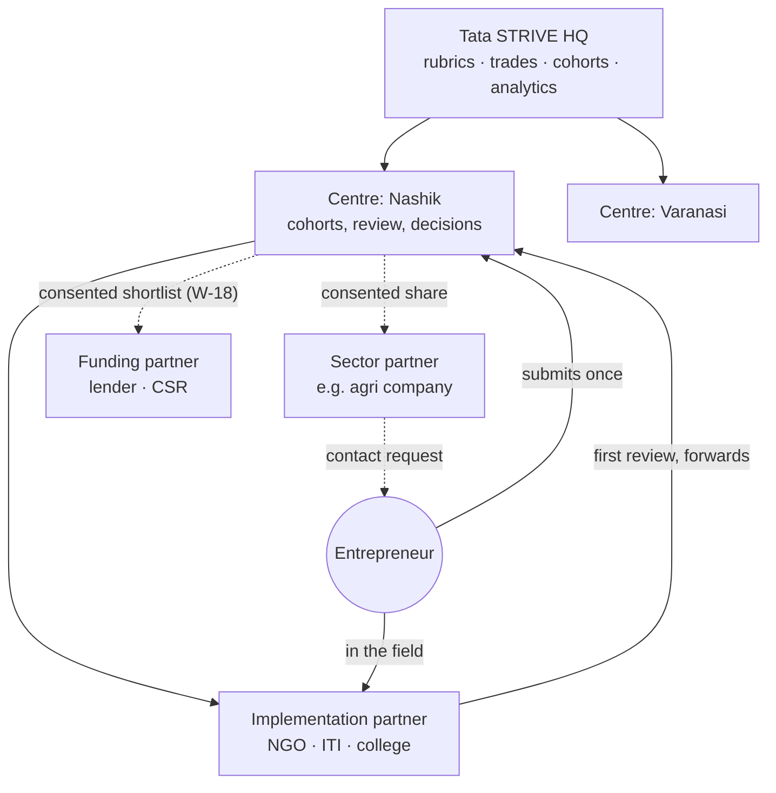
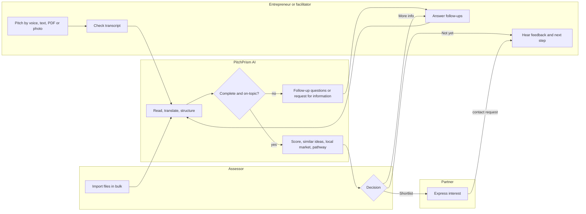
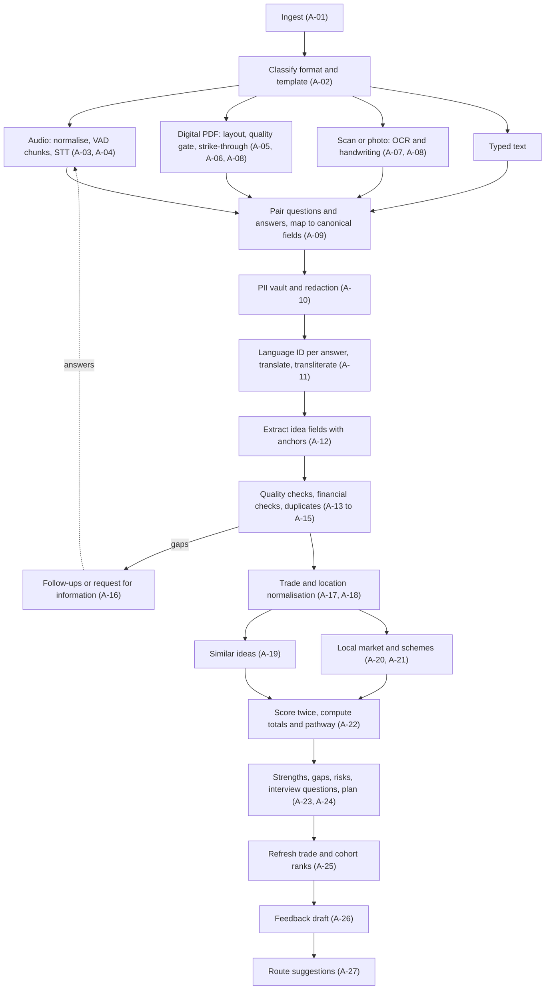
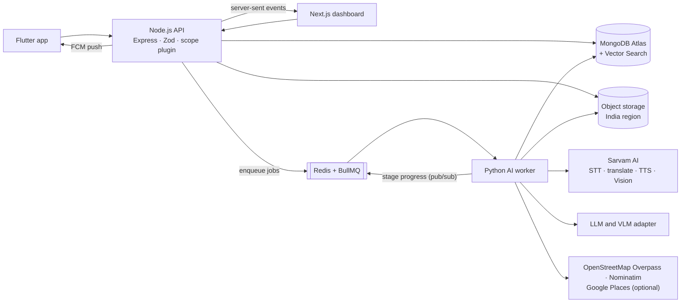

# PRD: PitchPrism — AI Idea Screening for Tata STRIVE

v2 · Oct 17, 2026 · @Rayyan Shaikh

**Implementation addendum · 17 October 2026.** [D-24](docs/decision.md) updates the provider/runtime strategy to local-only AI with zero hosted AI API spending and a lightweight Android client. This supersedes Sarvam/hosted-provider defaults below; all feature requirements, priorities, language/format support and acceptance targets remain unchanged. The four role-based developer assignments remain D-23. Track implementation and validation in [the complete requirement matrix](docs/implementation-matrix.md).

**What changed in v2.** Rewritten against the organisers' revised problem statement and the 55 sample files they shared. The 18-section structure of v1 grew to 26 sections; v1 is kept unchanged in `PitchPrism.v1.md`. In short:

- **New PS features:** similar-idea detection, nearby similar businesses, domain-, trade-, cohort- and cross-cohort ratings, and a rubric built on the PS's own parameters.
- **Grounded in the real data:** the actual EDP forms (a 10-question Idea Brief and an 11-page handwritten Business Plan), six languages including Telugu and Bengali, and the messy cases the organisers planted (missing, irrelevant, mixed-language and struck-through answers, changed question sets, duplicates).
- **Architecture:** a Python AI worker beside the Node API, a document-understanding layer, data-quality checks, an EDP financial-model checker, location intelligence on open data, and an evaluation harness that scores PitchPrism on the organiser dataset.
- **Everything from v1 stays:** the voice-first app, follow-ups, plan read-back, feedback in the entrepreneur's language, Idea Passport, consent routing and outcome tracking.

## 1. Overview

PitchPrism is a first-line screening and assessment tool: it reads business ideas submitted as voice, text, typed forms or handwritten PDFs in any of six Indian languages, and turns each one into a scored, evidence-linked English assessment that shows similar ideas, the local market and a recommended next step.

**Problem.** Tata STRIVE's Entrepreneurship Development Programme (EDP) asks candidates for a business plan, then a written test, a group activity and an interview ([Tata Trusts Horizons](https://horizons.tatatrusts.org/2024/april/tata-trusts-horizons-trained-to-thrive.html)). Applicants answer in the way that is most comfortable to them: a text field, an audio recording or an uploaded document, in many regional languages. The assessment team then has to read every format, translate, work out what is being proposed, and judge its potential. They also want context: has anyone else proposed something similar, and do similar businesses already operate nearby? Doing this by hand for every submission does not scale, and the written plan filters out people who can explain a business well but cannot write one.

| Pain point (from the problem statement) | Who feels it | What PitchPrism does |
| --- | --- | --- |
| Format diversity: text, audio, PDFs, handwritten scans | Assessors | One pipeline turns every format into the same structured idea card, keeping the original |
| Language barriers: many regional languages, often mixed in one answer | Entrepreneurs, assessors | Per-answer language detection and translation; English card for reviewers; feedback back in the entrepreneur's language |
| Manual translation and reading: slow evaluation | Assessors, Tata STRIVE | Automatic reading, translation and first-pass assessment within a minute for text and PDFs |
| Messy, incomplete or off-topic answers | Assessors | Data-quality checks say what is missing, irrelevant, overwritten or implausible instead of guessing |
| No view of overlaps across applicants | Assessors, HQ | Similar-idea and duplicate detection, idea clusters, saturation alerts |
| No picture of local competition | Assessors | Map of nearby similar businesses from open data, compared with what the applicant claimed |
| No consistent comparison across trades and batches | Centres, HQ | Domain-, trade-, cohort- and cross-cohort ratings on a versioned rubric |
| Context gaps: schemes, local market | Assessors, entrepreneurs | Location-aware notes and eligible government schemes, each with its source |

**Approach.** Two halves share one platform.

1. **The screening engine (the core of the PS).** Every submission, whether imported in bulk from the existing application or captured in our app, runs through the same pipeline: read → translate → structure → check quality → find similar ideas → add local context → score → recommend a pathway. Assessors see the result as one consolidated idea card.
2. **The multi-org network, in three layers (from v1):**
   1. **Hub-and-spoke backbone (build fully).** Tata STRIVE HQ is the hub; centres and implementation partners are spokes. This mirrors how Tata STRIVE already works through its own centres, extension centres and trained partners ([Tata STRIVE](https://tatastrive.com/what_we_do/enabling-jobs-and-livelihoods/)).
   2. **Consent-based routing (standout feature).** The entrepreneur submits once. With their consent, the idea reaches the partners who can help: sector partners, lenders, mentors.
   3. **Outcome tracking (light layer and vision).** Selected ideas are followed through training, funding and business status, feeding impact reports.

**Surfaces.** A Flutter mobile app for entrepreneurs and field facilitators. A Next.js web dashboard for HQ, centres and partners. A Node.js API with MongoDB. A Python AI worker for documents, audio, language, similarity and location. Sarvam AI for voice, translation and Indian-language documents.

### 1.1 What makes PitchPrism stand out

1. **Click any score, see the proof.** Every rating links to the exact words that earned it: the original sentence, its translation, and either the audio moment or a highlighted region on the scanned page.
2. **Reads forms as they really arrive.** Handwriting, struck-out answers, answers in a different language from the question, missing or changed questions, blurred scans. When it cannot read something, it says so instead of guessing.
3. **Checks the business-plan maths.** The EDP Business Plan has a built-in financial model (formulas A to N plus three cash books). PitchPrism recomputes it and shows where the numbers do not add up.
4. **One clear next step.** Each idea gets a potential score and a completeness score, plotted on a screening quadrant, and a suggested pathway: deeper evaluation, mentoring, skilling, funding consideration, or ask for more information.
5. **Idea intelligence across applicants.** Duplicates and resubmissions, similar ideas, idea clusters, saturation alerts ("4 food stalls proposed within 2 km in this cohort") and collaboration opportunities.
6. **Local market lens.** A map of similar businesses near the proposed location from open data, set against what the applicant said about competition, plus schemes they may be eligible for.
7. **Fair comparison at every level.** Domain-wise, trade-wise, cohort-wise and cross-cohort views, only ever comparing ideas scored on the same rubric version.
8. **Live idea card.** The card fills in stage by stage on screen; text and digital PDFs are ready in under a minute.
9. **Two-way language.** Follow-up questions and feedback are spoken to the entrepreneur in their own language.
10. **Fills the official plan for them.** From a voice pitch, PitchPrism drafts the EDP Business Plan with the arithmetic done correctly, and reads it back.
11. **Consent-first network.** The Idea Passport shows who can see an idea; partners see the idea, not the person, until the entrepreneur says yes.
12. **Measured, not claimed.** An evaluation harness runs the organisers' own 55 files on every prompt or rubric change and publishes accuracy, parity across languages and formats, latency and cost.

### 1.2 Problem statement traceability

Every requirement in the revised problem statement maps to a feature, its requirement IDs and the demo moment that shows it (section 24).

| PS requirement | How PitchPrism meets it | Requirement IDs | Demo step |
| --- | --- | --- | --- |
| Capture ideas from text, audio and PDFs | Intake channels and document understanding for every format, including scans and handwriting | A-01 to A-08, M-05, W-19 | 2 |
| Identify language, translate to English, retain the original | Per-answer language ID, segment-level translation, immutable originals, side-by-side view | A-04, A-11, A-01, W-20 | 3 |
| Present the idea in a simple structured format | Idea card with canonical fields | A-12, W-10 | 3 |
| Understand what, product or service, customers, problem, location, investment and revenue | Canonical field extraction including "problem addressed" and the investment profile | A-09, A-12 | 3 |
| Rate on clarity, customer need, market potential, feasibility, competition, differentiation, completeness | Default rubric uses exactly these domains | A-22, section 13 | 3 |
| Highlight strengths, gaps, risks, information to validate | Narrative block with evidence, plus interview questions | A-23, W-31 | 3, 5 |
| Identify similar ideas across beneficiaries | Embeddings, nearest neighbours, duplicates, clusters | A-15, A-19, W-22, W-27 | 4 |
| Location-based insights: similar businesses nearby | Geocoding, open-data places, official statistics, internal submissions | A-18, A-20, A-21, W-23 | 4 |
| Consolidated assessment view per beneficiary | Idea card v2 | W-10 | 3 to 5 |
| Domain-wise rating | Per-domain scores with evidence | W-10, section 14 | 3 |
| Trade-wise rating | Percentile and benchmark within the trade | W-24 | 7 |
| Cohort-wise rating | Rank and distribution within the cohort | W-25 | 7 |
| Across-cohort comparison | Distributions, trade × cohort heatmap, trends | W-26 | 7 |
| Help decide on deeper evaluation, mentoring, skilling or funding | Pathway recommendation and screening quadrant | A-22, W-28 | 6 |
| Beneficiaries not disadvantaged by language or format | Never-scored list, parity tests, fairness monitor | section 13, A-30, W-07 | 10 |
| Gaps help beneficiaries strengthen their idea | Feedback, improvement checklist and resubmission in their language | M-13, M-14, W-12 | 6, 8 |
| (a) Many languages and formats | Six languages at launch, any Sarvam language by configuration | section 6 | 2 |
| (b) Preferably real time | Live card over server-sent events; under 60 s for text and PDFs | A-28, section 22 | 2 |
| (c) Clear reasoning, not just a score | Evidence anchors on every domain score and flag | A-12, A-22, W-20 | 3 |
| (d) Original submissions retained | Originals stored immutably; every derived value points back to them | A-01, W-20 | 3 |
| (e) Reliable, available data sources for location and similarity | Official directories, OpenStreetMap, optional Google Places; every result shows source and date | section 16 | 4 |
| (f) Open-source or optimal, scalable models | Open-weights LLM and embeddings by default behind an adapter; Sarvam for Indian languages | section 18 | 10 |

## 2. Glossary

These terms have one meaning throughout the PRD, the code and the UI.

| Term | Meaning |
| --- | --- |
| Assessment domain | One rubric criterion, such as customer need or feasibility. "Domain-wise rating" in the PS means scores per assessment domain |
| Sector | The broad business area the application platform calls "Domain", such as Agriculture or Food service |
| Trade | The normalised business type, such as tailoring or dairy, mapped to NIC-2008 codes. Trade-wise ratings compare ideas within one trade |
| Programme | A Tata STRIVE offering run by a centre, such as EDP Varanasi |
| Cohort | One intake batch within a programme, such as EDP Varanasi, Oct 2026 |
| Submission | One idea from one entrepreneur, which may contain several documents (a PDF and a voice note) |
| Segment | The smallest piece of source text with an ID: an audio chunk, a PDF answer cell or a typed paragraph |
| Anchor | Where a segment lives in the original: audio start and end, PDF page and bounding box, or character range |
| Canonical field | One of the structured idea fields (Appendix B), whatever question wording or language produced it |
| Potential score | 0 to 100, weighted from the eight scored domains, using only evidence that exists |
| Completeness | 0 to 100, how much of the information an assessor needs is present and on-topic |
| Band | Strong, Promising or Not yet, from the potential score; an AI suggestion only |
| Pathway | The suggested next step: deeper evaluation, funding consideration, mentoring, skilling, request information, or re-submission with help |
| Screening quadrant | Potential plotted against completeness |

## 3. Goals, non-goals and success metrics

PitchPrism succeeds if an assessor can understand and fairly judge any submission, in any language or format, in under 3 minutes, and an entrepreneur can pitch by voice in under 5. Targets below are proposals for the team to confirm.

**Goals**

- **G1. Pitch in your own language.** Submit by voice, text, PDF or photo in Hindi, Marathi, Telugu, Odia, Bengali or English at launch. These are the six languages in the organiser data. Any other language Sarvam supports can be switched on by configuration.
- **G2. Review without translating.** Assessors read an English idea card with scores, not raw audio or handwriting.
- **G3. Explainable scores.** Every score and every flag links to the source segment that earned it.
- **G4. One platform, many orgs.** HQ, centres and partners share one system with strict data isolation and consent.
- **G5. Nobody leaves empty-handed.** Every applicant gets a next step in their language: shortlist, improve and resubmit, or a skilling course.
- **G6. Every idea in context.** Each card shows similar ideas across applicants and the local market around the proposed location.
- **G7. Fair comparison.** Ratings by domain, trade, cohort and across cohorts, on versioned rubrics.
- **G8. Robust to messy input.** Missing, irrelevant, mixed-language, overwritten, handwritten and non-standard submissions are handled explicitly and visibly.
- **G9. Near real time.** Text and digital PDFs are assessed within a minute; the card streams in as stages finish.

**Non-goals for the MVP**

- AI making final selection decisions. A human assessor always decides.
- Replacing EDP's group activity or personal interview. PitchPrism prepares the interviewer instead (W-31).
- Loan disbursal, payments or billing between orgs.
- Delivering skilling courses inside the app. It links out to them.
- iOS polish. Android comes first, since most target users are likely on low-cost Android phones.
- Scraping private or paid data sources. Location insights use open, official or properly licensed APIs only.

**Success metrics**

| Metric | Proposed target | How it is measured |
| --- | --- | --- |
| Submission completion rate | ≥ 70% of started pitches | App events: started vs submitted |
| Time to idea card | Text and digital PDF ≤ 60 s; scanned PDF ≤ 2 min; 5-min audio ≤ 3 min (p90) | Pipeline stage timestamps |
| Assessor review time | ≤ 3 min median | Dashboard time on card |
| Canonical field accuracy | ≥ 90% on organiser "accurate" files | Eval harness vs manifest (section 17) |
| Missing-field detection | ≥ 95% recall, ≥ 90% precision | Eval harness |
| Irrelevant-answer detection | 100% of fully irrelevant submissions marked Unassessable; ≥ 90% per-answer recall | Eval harness |
| Overwrite resolution | ≥ 90% of struck values replaced by the correction | Eval harness on overwritten scenarios |
| Duplicate detection | All planted duplicates flagged; zero automatic merges | Eval harness |
| Score gap across languages and formats | Within 5 points on a 100-point scale | Parity groups in the manifest; live fairness monitor |
| Assessor agreement with AI pathway | Tracked; review if < 60% | Final decision vs AI pathway |
| Transcript fixes needed | ≤ 20% of submissions | Entrepreneur or facilitator edits |
| Applicants receiving feedback in their language | 100% | Feedback delivery log |
| AI cost per submission | Logged per stage; target set after the first eval run | Pipeline runs |

## 4. Users, organisations and roles

PitchPrism serves one entrepreneur-facing role on mobile and five organisation roles on the web, plus field facilitators who use the mobile app on someone's behalf.

**Personas**

- **Sunita, entrepreneur (mobile).** 32, from a village near Nashik, speaks Marathi, reads a little. Runs a self-help group and wants to start a papad and pickle unit. Comfortable with WhatsApp voice notes, not with forms.
- **Ravi, field facilitator (mobile, assisted mode).** Works at a Tata STRIVE centre or partner NGO. Records pitches for people without a smartphone or data, often with poor connectivity.
- **Meera, centre assessor (web).** EDP staff at a Tata STRIVE centre. Reviews 20 to 50 ideas a week, speaks Hindi and English, not Odia or Marathi. On intake days, receives a batch of PDFs, scanned handwritten plans and voice notes exported from the application platform and needs them all screened the same day.
- **Kavya, cohort lead (web).** Runs one EDP intake at a centre. Compares ideas within the cohort and within each trade, picks who goes to interview, and explains choices to HQ.
- **Arjun, HQ programme admin (web).** Sets the scoring rubric, trades and cohorts, onboards partner orgs, checks quality and fairness, compares cohorts and reports to funders.
- **Partner reviewers (web).** Staff at implementation partners, sector partners (such as auto or agri) and funding partners. Each sees only what their role and the entrepreneur's consent allow.

**Organisation types**

| Org type | Example (illustrative, not confirmed partners) | Role in the network |
| --- | --- | --- |
| HQ | Tata STRIVE programme team | Owns rubrics, trades, cohorts, partner onboarding, quality checks, analytics |
| Centre | Tata STRIVE skill development or extension centre | Collects, imports and reviews ideas in its region; runs cohorts; decides shortlists |
| Implementation partner | NGO, ITI or college trained by Tata STRIVE | Collects ideas in the field; first-level review |
| Sector partner | Auto-sector or agri-sector company | Mentoring and market links for ideas in its sector |
| Funding partner | Lender or CSR funder | Lenders see loan-ready shortlists; CSR funders see impact reports only |

**Permission matrix**

| Capability | HQ admin | Centre assessor | Implementation partner | Sector partner | Funding partner | Facilitator (mobile) |
| --- | --- | --- | --- | --- | --- | --- |
| Configure rubrics, trades and programmes | Yes | No | No | No | No | No |
| Create cohorts | Yes | Own centre | No | No | No | No |
| Onboard orgs and users | Yes | Own centre users | Own org users | Own org users | Own org users | No |
| Import submissions in bulk | Yes | Own centre | Own org | No | No | No |
| See ideas | All | Own centre | Own org | Consented only | Consented shortlist only | Own submissions |
| See name and phone number | Yes | Own centre | Own org | After entrepreneur accepts | After entrepreneur accepts | Own submissions |
| Similar ideas from other orgs | Full | Counts and anonymised summaries | Counts only | No | No | No |
| Score and decide | Override | Yes | First-level review | No | No | No |
| Add mentoring notes | Yes | Yes | Yes | Yes | No | No |
| Route an idea to partners | Yes | Yes | Suggest only | No | No | No |
| Trade and cohort ratings | All orgs | Own centre | Own org | No | No | No |
| Cross-cohort comparison | All orgs | Own centre's cohorts | No | No | No | No |
| Aggregate analytics | All orgs | Own centre | Own org | Own org | Impact reports | No |
| Submit on someone's behalf | No | No | No | No | No | Yes |

## 5. Multi-org model

PitchPrism runs as one hub with many spokes, adds consent-gated routing to partners, and keeps a light outcome record for every selected idea.

Ideas move up from entrepreneurs to centres and HQ; they move sideways to partners only through the entrepreneur's consent. Funding partners join the routing layer later (W-18).

- **Layer 1, hub-and-spoke.** Every org has a parent: centres report to HQ, implementation partners to a centre. The centre owns each submission; the partner that collected it is recorded as its source. HQ sees everything; sibling orgs never see each other's ideas.
- **Programmes and cohorts.** A centre runs programmes; each programme has cohorts (intake batches). Every submission belongs to one cohort, which is what cohort-wise ratings compare within.
- **Layer 2, consent-based routing.** A routing rule maps a sector or trade and a set of districts to partner orgs. Suggestions only include partner types the entrepreneur allowed. A share moves through Suggested, Sent, Viewed, Interested, Contact requested, then Contact accepted or Declined. The entrepreneur can revoke at any time.
- **Layer 3, outcome tracking.** Centres record stages after selection. HQ and funders see totals, never personal data.
- **Similar ideas respect the hierarchy.** A centre sees similar ideas from its own cohorts in full, and from other centres only as counts and anonymised summaries. HQ sees everything.
- **Adding an org needs no code.** HQ creates the org, sets its type, parent, region and sectors, then invites its first admin. The same setup could later onboard other incubators or CSR programmes.

## 6. Intake channels and formats

Every channel ends in the same pipeline, so a handwritten plan imported in bulk and a voice pitch from the app are assessed identically.

**Channels**

| Channel | Who uses it | Priority |
| --- | --- | --- |
| Dashboard upload: single files, multi-select, or a ZIP of a whole intake (W-19) | Assessors, cohort leads | P0 |
| Mobile app: guided voice, free talk, typing, upload or photo of a paper form (section 8) | Entrepreneurs | P0 |
| Assisted mode on a shared phone, with offline queue | Facilitators | P0 |
| Web intake link (PWA): the same pitch flow in a phone browser, no install | Entrepreneurs without the app | P1 |
| Application platform export or webhook: pull new submissions automatically | Tata STRIVE IT | P1, depends on Q-19 |
| WhatsApp: send a voice note or a photo of a form to a number | Entrepreneurs | P2 |

**Formats**

| Format | Examples in the organiser data | Handling |
| --- | --- | --- |
| Typed text | App text answers | Split into segments by answer |
| Digital PDF with a text layer | EDP Idea Brief; platform exports (Chromium, ReportLab) | Layout-aware parsing; Indic quality gate (A-05, A-06) |
| Scanned or photographed PDF | 11-page handwritten EDP Business Plan | OCR and handwriting reading (A-07) |
| Images | Photo of a paper form | Treated as a one-page scan |
| Audio | AAC in .mp4 or .3gp (phone recorder), Opus in .ogg (WhatsApp-style); also .m4a, .wav, .mp3, .webm | Converted to 16 kHz mono, chunked under 30 s (A-03) |
| Mixed bundle | A PDF plus a voice note from the same person | One submission, several documents; fields merge with source tracking |

**Languages.** Hindi, Marathi, Telugu, Odia, Bengali and English at launch, plus code-mixed speech and writing. Language is detected per answer, not per document, because the organiser data has questions in one language and answers in another, and single answers that switch language mid-sentence.

## 7. Main user flows

The core flow takes an idea from a pitch or an imported file to a decision and a partner match. A human decides in the middle, and everyone who is not shortlisted gets a feedback path.

The entrepreneur and the AI pass the idea back and forth until it is complete; only then does an assessor see it as "ready". A third decision, More info, sends new questions back to the Answer follow-ups step.

**Other flows**

1. **Assisted pitch.** A facilitator logs in, adds a new applicant, records their spoken consent, then runs the same pitch steps on a shared phone. Submissions queue offline and sync later; the centre sees the facilitator's org as the source.
2. **Bulk import.** An assessor drops a ZIP of an intake onto the dashboard and picks the cohort. Each file becomes a submission, or joins an existing one when the same applicant is detected. The queue fills in live, with language and format chips per row. Files that cannot be read go to a "Needs attention" lane with the reason.
3. **Unassessable submission.** When most answers are off-topic or empty, PitchPrism does not score. It marks the submission Unassessable, lists what is missing, and drafts a request for information in the applicant's language. App users receive it as a follow-up; imported submissions get a printable or SMS version for the centre to send.
4. **Duplicate review.** When a new submission matches an existing one (same contact and similar idea, or near-identical text), the assessor sees both side by side and chooses: link as a resubmission, mark as different people, or ignore. Nothing merges automatically.
5. **Partner-collected idea.** An implementation partner does a first review and forwards the idea to its linked centre, which makes the decision.
6. **Revoking consent.** In the Idea Passport, the entrepreneur turns off sharing for a partner type. Open shares close, and partners lose access on their next request.
7. **Not yet and resubmit.** The entrepreneur gets an improvement checklist and suggested courses, edits or re-records, and resubmits. The new evaluation is linked to the old one, and the card shows what improved.
8. **Rubric change.** HQ publishes a new rubric version. Existing evaluations keep their version. A cohort lead can re-score the cohort on the new version, and comparisons only mix ideas scored on the same version.
9. **HQ onboards a partner.** HQ creates the org, sets its type, parent and sectors, adds a routing rule, and invites its first admin.

## 8. Mobile app requirements (Flutter)

The mobile app is voice-first and works for someone who cannot read well, has a cheap Android phone and patchy data. P0 = must ship for the demo, P1 = build if time allows, P2 = later.

| ID | Area | Requirement | Priority |
| --- | --- | --- | --- |
| M-01 | Onboarding | First screen is a language picker with an audio prompt per language (Hindi, Marathi, Telugu, Odia, Bengali, English) | P0 |
| M-02 | Onboarding | Phone number login with OTP | P0 |
| M-03 | Onboarding | Consent screen read aloud in the chosen language. Processing consent is required; partner sharing is separate and optional | P0 |
| M-04 | Onboarding | Short profile by voice or tap: name, district or pincode, trade or skill, optional gender | P0 |
| M-05 | Pitching | Home has three large options: Speak, Type, Upload (PDF, or a photo of a filled paper form or handwritten plan) | P0 |
| M-06 | Pitching | Guided voice mode: spoken prompt cards for the EDP questions (Appendix B), grouped into 5 short steps (what you will sell, who buys, where, money needed, your skills), up to 2 minutes each, pause and re-record | P0 |
| M-07 | Pitching | Free-talk mode: one recording of up to 5 minutes for people who prefer to just talk | P1 |
| M-08 | Pitching | Transcript review in the user's script, with tap-to-edit and audio playback | P0 |
| M-09 | Pitching | AI follow-up questions: 3 to 5 questions about missing or unclear fields, asked in text and audio, answered by voice | P0 |
| M-10 | Pitching | Plan read-back: the generated plan in the user's language, played aloud, with Confirm or Fix something. The plan follows the EDP Business Plan structure, with its financial section computed correctly (A-24) | P0 |
| M-11 | Pitching | Recordings saved on the device and uploaded when online; resumes after the app closes | P0 |
| M-12 | Status | Status timeline: Submitted, Under review, Decision, with push notification on change | P0 |
| M-13 | Feedback | Feedback in the user's language as text and audio: strengths, gaps, and one clear next step | P0 |
| M-14 | Feedback | Not-yet path: an improvement checklist, suggested skilling courses and a Resubmit button | P1 |
| M-15 | Idea Passport | See which organisations can see the idea; grant or revoke sharing per partner type; accept or decline a partner's contact request | P0 |
| M-16 | Notifications | SMS fallback when push fails | P1 |
| M-17 | Assisted mode | Facilitator login with org role; New applicant flow on a shared device; recorded spoken consent plus a checkbox | P0 |
| M-18 | Assisted mode | Queue of many applicants offline with per-item sync status; facilitator sees only their own submissions | P0 |
| M-19 | App-wide | Large touch targets, icons with audio labels, Android 8 and above, small download size | P0 |
| M-20 | Web intake | The same pitch flow as a PWA in a phone browser, for people without the app | P1 |
| M-21 | WhatsApp | Accept a voice note or form photo sent to a WhatsApp number; reply with status and feedback audio | P2 |
| M-22 | Resubmission | After a resubmit, show "what improved" in plain language and audio | P1 |
| M-23 | Schemes | Hear the government schemes the idea may qualify for, in the user's language, with where to apply | P1 |

## 9. Web dashboard requirements (Next.js)

The dashboard is one Next.js app; what each user sees depends on their org type and role. The centre assessor's idea card is the most important screen in the product.

| ID | View | Requirement | Priority |
| --- | --- | --- | --- |
| W-01 | HQ | Create orgs (type, region, languages), invite users, assign roles | P0 |
| W-02 | HQ | Programme and rubric setup: domains, weights, score descriptors, band thresholds, pathway rules; each change saved as a new version | P0 (form), P1 (visual builder) |
| W-03 | HQ | Pipeline across all orgs, filtered by centre, cohort, language, trade, sector, district, status, band and pathway | P0 |
| W-04 | HQ | Routing rules: which partner orgs receive which trades, sectors and districts | P0 |
| W-05 | HQ | Funnel analytics by centre and cohort: submitted, reviewed, shortlisted, enrolled, funded | P0 |
| W-06 | HQ | Quality check: a random sample of AI-scored ideas for a second human review; overrides logged | P1 |
| W-07 | HQ | Fairness monitor: score distributions by language, input format, gender and district, with alerts on gaps over 5 points | P1 |
| W-08 | HQ | Audit log of who viewed, scored, routed or exported which idea | P1 |
| W-09 | Centre | Review queue for the centre, sortable by score, completeness, date and language, with lanes: Ready, Needs attention, Unassessable, Possible duplicate | P0 |
| W-10 | Centre | **Idea card v2.** Header with trade, sector, cohort, district, language and format chips, and data-quality flags. Recommendation strip with band, pathway and quadrant position. English summary and canonical fields. Domain scores, each with the quote that earned it. Strengths, gaps, risks and items to validate. Financial checks. Similar ideas. Local market. Trade and cohort rank. Original and translation side by side. Audio player and page viewer that jump to the quoted moment or region | P0 |
| W-11 | Centre | Decisions: Shortlist, Not yet, or Ask for more information (sends questions to the app or prints a request). Overriding the AI band or pathway requires a reason | P0 |
| W-12 | Centre | Edit AI-drafted feedback in English; it is translated back and sent as text and audio | P0 |
| W-13 | Centre | Route to partners: suggested partners with the reason, limited to partner types the entrepreneur allowed | P0 |
| W-14 | Centre | Mentoring notes and mentor assignment | P1 |
| W-15 | Centre | Outcome updates: enrolled, training completed, loan applied or received, business started, 3-month and 6-month status | P1 |
| W-16 | Implementation partner | Own submissions, first-level review, forward to the linked centre | P0 |
| W-17 | Sector partner | Consented ideas in its sector; Express interest sends a contact request to the entrepreneur | P0 (one partner type in demo) |
| W-18 | Funding partner | Consented loan-ready shortlist; CSR impact report with totals only, no personal data | P2 |
| W-19 | Centre | Bulk import: drag in files or a ZIP, choose the cohort, see per-file progress, detected language and format, and errors | P0 |
| W-20 | Centre | Original viewer: rendered PDF pages with the evidence region highlighted and struck values shown crossed out; audio waveform that jumps to a segment; typed text with highlights. Personal details are blurred for roles that may not see them | P0 |
| W-21 | Centre | Data-quality panel on the card: missing, not asked, irrelevant, overwritten, implausible, inconsistent, language mismatch, possible duplicate, low OCR confidence, each linked to its segment | P0 |
| W-22 | Centre | Similar ideas panel: nearest ideas with similarity, trade, district, distance and status; duplicates highlighted | P0 |
| W-23 | Centre | Local market panel: map of the location with nearby similar businesses by radius, counts, source and date; the applicant's own competition claim beside it; saturation note; eligible schemes with sources | P0 |
| W-24 | Centre, HQ | Trade view: all ideas in one trade, domain benchmarks (median and spread), each idea's percentile, investment against the trade norm | P0 |
| W-25 | Centre | Cohort view: ranking, score and completeness distributions, trade and language mix, pathway counts, shortlist builder, export | P0 |
| W-26 | Centre, HQ | Cross-cohort comparison: side-by-side distributions, trade × cohort heatmap, completeness by cohort, pathway mix, trends over intakes | P0 |
| W-27 | HQ | Idea map: a 2D map of all ideas by similarity, coloured by trade or cohort, with named clusters and saturation alerts | P1 |
| W-28 | Centre | Screening quadrant: potential against completeness for a cohort, click a dot to open the card | P0 |
| W-29 | Centre, HQ | Exports: one-page assessment PDF per idea; cohort spreadsheet with all fields, scores and flags | P1 |
| W-30 | Centre, HQ | Assessor copilot: ask questions about an idea or a cohort in plain language ("which dairy ideas in Satara did market research?"), answered from scoped data with links to the cards | P1 |
| W-31 | Centre | Interview kit: questions for the EDP interview generated from the gaps and items to validate, printable per applicant | P1 |
| W-32 | HQ, Centre | Cohort and trade admin: create cohorts, edit the trade list, synonyms and OSM tags | P0 |
| W-33 | HQ | Model quality page: latest eval run on the organiser dataset (accuracy, parity, latency, cost) and its history | P1 |
| W-34 | Centre | Compare 2 or 3 ideas side by side, field by field and domain by domain | P1 |
| W-35 | Centre | Duplicate review: compare two submissions, link as resubmission, mark as different people, or dismiss | P1 |

## 10. AI pipeline

Sarvam AI handles everything language-related, a Python worker handles documents, audio, similarity and location, and an LLM behind an adapter handles understanding and scoring. Every output keeps segment IDs so any score or flag can be traced back to the exact words, audio moment or page region.

| Job | Service | Notes |
| --- | --- | --- |
| Speech to text | Sarvam Saaras v3, `mode="transcribe"` | 22 Indian languages, code-mixed speech, language detection ([Sarvam STT docs](https://docs.sarvam.ai/api-reference-docs/api-guides-tutorials/speech-to-text/overview)) |
| Translation | Sarvam translation (Mayura or Sarvam-Translate) | Segment by segment, so IDs survive |
| Transliteration | Sarvam transliteration | Shows Telugu or Odia text in Latin or Devanagari script for assessors who cannot read the original script |
| Text to speech | Sarvam Bulbul v3 | Follow-up questions, plan read-back, feedback ([Sarvam docs](https://docs.sarvam.ai/index.md)) |
| Scanned PDFs, photos, handwriting | Sarvam Document AI (Sarvam Vision); a vision-language model through the adapter as fallback | Chosen per page by confidence; compared on the organiser's handwritten plans (section 17) |
| Digital PDF layout | PyMuPDF in the worker | Spans with bounding box, font and colour; drawn lines for strike-through detection |
| Extraction, quality judgements, scoring, narrative | LLM via adapter: an open-weights model by default (Q-04) | JSON output validated against a schema |
| Embeddings | Open-source multilingual model (BGE-M3 class), run in the worker | Similar ideas and question-bank matching |
| Places and geocoding | OpenStreetMap Overpass and Nominatim; Google Places optional | Cached; only coarse location and trade are sent |

**Limit that shapes the design.** Sarvam's synchronous speech-to-text accepts at most 30 seconds per request; longer audio goes to the Batch API, which takes files up to 2 hours ([Sarvam STT FAQ](https://docs.sarvam.ai/api-reference-docs/speech-to-text/faq.md)). Every organiser recording is longer than 30 seconds (99 to 353 s). PitchPrism splits audio at pauses into chunks under 30 seconds and transcribes them in parallel. That is faster than a batch job and keeps timestamps for each chunk. Recordings over 10 minutes fall back to the Batch API.

**Pipeline requirements**

| ID | Stage | Requirement | Priority |
| --- | --- | --- | --- |
| A-01 | Ingest | Store every original file unchanged, with its hash, in private storage; create the submission and documents; queue the job | P0 |
| A-02 | Classify | Detect the format (audio, digital PDF, scanned PDF, image, text), the script per page, and the template by fingerprint (known: EDP Idea Brief, EDP Business Plan, platform exports; otherwise "unknown") | P0 |
| A-03 | Audio | Convert to 16 kHz mono with ffmpeg; split at silences with a voice-activity detector into chunks under 30 s, each with its start time; reject near-silent or clipped audio with a re-record prompt | P0 |
| A-04 | Transcribe | Transcribe chunks in parallel within Sarvam's rate limits, with language detected per chunk; output segments with ID, language, text, start and end | P0 |
| A-05 | Digital PDF | Extract text spans with bounding box, font and colour, plus drawn lines and table rules; rebuild question and answer cells from the layout, not the content-stream order | P0 |
| A-06 | Quality gate | Score each Indic text span for corruption (orphan vowel signs, broken conjuncts, unknown syllables). Spans below the threshold are re-read from the rendered page by OCR. Organiser PDFs from Chromium and Word lose pre-base vowel signs, so this is routine | P0 |
| A-07 | Scans and handwriting | Render pages at 300 dpi; detect blur and skew; read with Sarvam Document AI, falling back to a vision model for handwriting with low confidence; resolve ditto marks in tables; return per-region confidence | P0 |
| A-08 | Overwrites | Detect struck-through or scribbled text (a drawn line through a span, grey versus blue ink, scribbles on scans). Keep both values; the correction becomes the answer and the struck value is shown as history | P0 |
| A-09 | Structure | Pair questions with answers whatever the template. Map each question to a canonical field (Appendix B) by matching against a multilingual question bank with embeddings, confirmed by the LLM. Questions the template did not ask are recorded as "not asked". Unknown questions are kept as additional Q&A | P0 |
| A-10 | PII | Move name, phone, email, exact address and social category into the encrypted entrepreneur record. Redact them from every segment before any LLM call, and mark their regions on page images for blurring | P0 |
| A-11 | Language | Identify the language of every answer separately; translate each segment to English, keeping its ID; transliterate on request. Code-mixed answers are translated whole, never truncated to one language | P0 |
| A-12 | Extract | Fill the canonical idea fields, "problem addressed" and a one-line summary. Each field cites segment IDs. A field with no citation is dropped, never invented | P0 |
| A-13 | Quality checks | Run the checks in section 12: completeness, relevance per answer, consistency, plausibility, language mismatch, placeholder contacts | P0 |
| A-14 | Financial checks | Recompute the EDP Business Plan model (Appendix B.2): C = A − B, D = C, G = E + F, H = G / 30, I = E × 6, L = J + K, M = L / 30, N = min(1,00,000 − D − I, J × 5), and cash-book totals against A, E × 6 and J × 5. Also check simpler forms: investment = self + loan, and revenue against price × volume. Every mismatch shows the written value, the expected value and the anchor | P0 |
| A-15 | Duplicates | Match on a salted hash of the normalised phone and email, plus embedding similarity. Flag possible duplicates and resubmissions; detect placeholder contacts; never merge automatically | P0 |
| A-16 | Follow up | For app submissions, write 3 to 5 questions about missing or unclear fields; translate and voice them; answers re-run the reading and extraction stages. For imported files, draft a request for information in the applicant's language | P0 |
| A-17 | Trade | Normalise the business type to the trade list (NIC-2008 codes, multilingual synonyms); record the sector | P0 |
| A-18 | Location | Parse village, block or mandal or taluka, district, state and PIN; normalise against the India Post pincode directory and LGD codes; geocode with a precision level (PIN, village, block, district) | P0 |
| A-19 | Similar ideas | Embed an "idea fingerprint" (trade, offering, customers, model) and find nearest neighbours within the user's scope; cluster per cohort and district (section 15) | P0 (neighbours), P1 (clusters) |
| A-20 | Nearby businesses | Query OpenStreetMap for places matching the trade's tags around the location at 1, 3 and 10 km; optionally Google Places; add PitchPrism's own nearby submissions; cache results (section 16) | P0 |
| A-21 | Context | Match district, trade, gender and social category against the curated schemes dataset; add official district statistics where available. The LLM only phrases what the data returns | P0 (schemes), P1 (statistics) |
| A-22 | Score | Score each domain 1 to 5 with a reason, evidence segment IDs and a confidence level. Run twice; if any domain differs by more than 1 point, flag for close review. Potential, completeness, band, quadrant and pathway are computed in code, not by the LLM | P0 |
| A-23 | Narrative | Strengths, gaps, risks, items to validate and interview questions, each citing segments or checks | P0 |
| A-24 | Plan | Draft the plan in English following the EDP Business Plan structure, with the financial section computed from the applicant's numbers; translate and voice it for read-back (M-10) | P0 (summary plan), P1 (full EDP structure) |
| A-25 | Rank | After each evaluation, refresh trade and cohort percentiles for that rubric version | P0 |
| A-26 | Feedback | Draft strengths, gaps and one next step in English; after the assessor edits it, translate and voice it | P0 |
| A-27 | Route | Routing rules filter partners by trade, sector and district, then by the entrepreneur's consent. Each suggestion shows its reason | P0 |
| A-28 | Live card | Publish each stage's result as it finishes, so the dashboard card fills in progressively over server-sent events | P0 |
| A-29 | Cost and timing | Log model, tokens, cost and duration per stage | P1 |
| A-30 | Evaluation | Run the organiser dataset through the pipeline on every prompt, model or rubric change and compare against the manifest (section 17) | P0 |

**Guardrails.** Prompts, rubrics and models are versioned and stored with each result. Personal data never goes to the LLM or to place and geocoding services. Low temperature, schema validation and one automatic retry on invalid output. Every extracted value and every judgement must cite a segment or a computed check; uncited output is discarded.

## 11. Document understanding

PDFs are the main input in the organiser data (42 of 55 files), and they fail in specific, repeatable ways. This section records those ways and how PitchPrism handles each.

| What the data shows | Why naive extraction fails | PitchPrism's handling |
| --- | --- | --- |
| Indic text exported by Chromium or Word | The text layer drops pre-base vowel signs and breaks conjuncts ("बज़नेस" for "बिज़नेस", "తెలంణ" for "తెలంగాణ") | Quality gate per span; re-read corrupted spans from the rendered page by OCR (A-06) |
| Struck-through answers with corrections | Strike lines are drawings, invisible in plain text; corrections are drawn late, so stream order is not reading order | Layout parsing with colour and drawn lines; keep struck and final values (A-05, A-08) |
| 11-page handwritten Business Plan, scanned | No text layer; mixed Devanagari and Latin handwriting; blurred pages; ditto marks; printed headers that render as empty boxes | OCR plus handwriting model with per-region confidence; blur warnings; ditto resolution (A-07) |
| Questions in Telugu, answers in Hindi (and other pairs) | A per-document language guess mistranslates half the content | Language ID per answer (A-11) |
| Questions missing, reordered, added or replaced | Fixed-position parsing maps answers to the wrong fields | Schema-agnostic Q&A pairing with a multilingual question bank; "not asked" recorded separately from "unanswered" (A-09) |
| Blank markers such as "[Left Blank]" or "[Not Answered]" | Read as content | Recognised as missing |
| Five different templates, plus a case-study paper with no applicant profile | Template-specific code breaks on the next form | Template fingerprinting for known forms; generic pairing for everything else |
| Personal details printed on the page | Sent to the LLM with the content | Captured to the PII vault and redacted before any model call (A-10) |

**Reading strategy per page.** Digital pages with clean text use the text layer. Digital pages that fail the quality gate are read by OCR, but only for the failing regions. Scanned pages go to Sarvam Document AI first; regions below the confidence threshold go to the vision fallback; regions still below it are flagged "could not read" on the card with the image crop, so the assessor can read them directly.

## 12. Data quality and integrity checks

PitchPrism separates "the idea is weak" from "the submission is incomplete, off-topic or inconsistent", and makes every data-quality issue visible on the card with a link to its source.

| Check | Rule | Effect |
| --- | --- | --- |
| Missing | A canonical field has no answer, or a blank marker | Lowers completeness; generates a follow-up or request |
| Not asked | The template had no question for the field | Lowers completeness, but the applicant is not blamed; the request explains it was not asked |
| Irrelevant | The LLM judges the answer does not address its question (for example cricket scores under "Who are your customers?") | The answer is excluded from scoring and flagged |
| Unassessable | More than half of the core fields are missing or irrelevant | No scores; pathway is "re-submit with help"; request drafted in the applicant's language |
| Overwritten | Struck or scribbled value with a correction | The correction is used; the history is shown |
| Implausible | Numbers outside sensible ranges, such as monthly revenue over 20× investment, or "₹1 crore a day" against a ₹95,200 investment | Flagged for validation; revenue logic cannot score above 2 on implausible numbers alone |
| Inconsistent | Profile against answers (business type vs offering, address vs location); investment ≠ self + loan; EDP financial formulas (A-14) | Flagged with written and expected values |
| Language mismatch | Answer language differs from question language | Shown as information only; never scored |
| Low read confidence | OCR or handwriting confidence below threshold, or a blurred page | Flagged with the image crop; affects confidence, not the score |
| Placeholder contact | Dummy numbers or emails, such as 9000000080 or @demo.com | Flagged; excluded from duplicate matching |
| Possible duplicate | Same contact hash plus similar idea, or near-identical idea text | Duplicate review (W-35); never merged automatically |
| Shared contact, different idea | Same phone number, different person and idea | Shown as information; not treated as a duplicate |

## 13. Scoring rubric, pathways and fairness

The default rubric scores the PS's own assessment parameters plus EDP's emphasis on drive and skills, and explicitly ignores how well someone writes or speaks. HQ can edit domains and weights per programme; the weights below are a proposed starting point.

**Potential domains (scored 1 to 5 by the LLM, weighted in code)**

| Domain | Weight | Scores 1 when… | Scores 5 when… |
| --- | --- | --- | --- |
| Clarity of the idea | 10% | Cannot tell what is being sold or to whom | Clear offering, customer and how it reaches them |
| Customer need | 15% | No problem or need named | Names who buys, why, and how often; evidence they need it |
| Market potential | 15% | No sense of demand | Local demand evidence: market research, numbers, seasonality |
| Feasibility and resources | 15% | Start-up cost unknown or far beyond reach; no suppliers or premises | Realistic cost within programme support, named suppliers, premises and infrastructure planned |
| Competition awareness | 10% | Denies or ignores competition | Names local competitors and how they operate |
| Differentiation | 10% | Same as everyone else | A clear, credible reason customers would choose this business |
| Revenue and financial logic | 15% | No idea how money is made | Price, cost, volume and margin reasoning; consistent numbers; funding plan |
| Entrepreneur readiness | 10% | Idea only, no link to skills or action | Relevant trade, training or experience; has already tested, sold, saved or started |

**Completeness (computed in code, not by the LLM).** The share of canonical fields that are present, on-topic and readable, weighted by importance (offering, customers, location, funding and price count more). It is shown as the ninth assessment domain, "Completeness of information", so the domain-wise rating covers every PS parameter.

**Rules**

- **Bands (AI suggestion only; the assessor decides).** Potential 70 and above: Strong. 50 to 69: Promising. Below 50: Not yet.
- **Missing is not weak (changed from v1).** A domain with no evidence is "Not assessed", not capped at 2. Potential is computed over the assessed domains, and coverage (the share of weight assessed) is shown beside it. If coverage is below 60%, the band is "Insufficient information" and the pathway is Request information. In the app, follow-up questions run first.
- **Never scored.** Grammar, English, business jargon, accent, handwriting, pitch length, file format, template, or the language of any answer. The scoring prompt says so explicitly, and the parity tests check it.
- **Evidence.** Every domain score cites 1 to 3 segment IDs. The idea card shows the English quote, the original words, and a play button or page highlight at that spot.
- **Two runs.** Each score carries a confidence level. Low confidence, or two scoring runs that disagree by more than 1 point, puts the idea in the Needs attention lane.

**Screening quadrant and pathways.** Potential (high = Strong or Promising) against completeness (high = 70 or above) gives four quadrants, and each maps to a suggested pathway. The PS asks PitchPrism to help decide which ideas need deeper evaluation, mentoring, skilling or funding consideration; these rules make that explicit and auditable.

| Situation | Suggested pathway |
| --- | --- |
| Strong, complete, feasibility ≥ 4, loan need within the programme limit | Funding consideration (and deeper evaluation) |
| Strong or Promising, and complete | Deeper evaluation (interview) |
| Promising with gaps in market, competition or financial logic | Mentoring |
| Readiness ≤ 2, or Not yet with a clear skill gap | Skilling, with suggested courses |
| Any potential, completeness below 70 | Request information |
| Unassessable (section 12) | Re-submit with help from a facilitator |

**Fairness checks**

- **What the LLM never sees.** Name, gender, phone, email, exact address and social category are never sent. Gender and category are optional, used only for scheme eligibility and aggregate monitoring.
- **Calibration set.** The organiser dataset is the starting calibration set, with expected behaviour per file in `datasets/manifest.json`. The team adds its own recordings over time.
- **Same idea, different language.** Ideas in the same parity group (the same idea in English, Marathi and Telugu, or in Hindi and Telugu) must score within 5 points; larger gaps block a prompt release.
- **Same idea, different format.** A persona's PDF and their voice response must also score within 5 points.
- **Live monitor (W-07).** Average scores by language, input format, gender and district. A gap above 5 points raises an alert for HQ, since it often points to a transcription or OCR problem rather than weaker ideas.

## 14. Ratings and comparison

PitchPrism produces the four ratings the PS asks for, and only ever compares ideas scored on the same rubric version.

| Rating | What it shows | Where |
| --- | --- | --- |
| Domain-wise | Score per assessment domain with evidence and confidence, plus completeness, as a bar or radar chart | Idea card (W-10) |
| Trade-wise | The idea's percentile within its trade; domain medians and spread for the trade; investment and price against the trade norm; "rank 3 of 17 tailoring ideas" | Card strip and trade view (W-24) |
| Cohort-wise | Rank within the cohort; score and completeness distributions; pathway counts; shortlist builder | Card strip and cohort view (W-25) |
| Across cohorts | Side-by-side distributions, trade × cohort heatmap, completeness and pathway mix by cohort, trends over intakes, shared clusters | Cross-cohort view (W-26) |

**Rules**

- Percentiles are recomputed after each evaluation (A-25) and stored as snapshots, so a card shows the rank it had when decided.
- With fewer than 5 ideas in a trade within a cohort, the card falls back to the trade benchmark across the centre, then across HQ, and says which it used.
- Cross-cohort comparisons show sample sizes and never rank individual people across centres for anyone below HQ.
- Low completeness by cohort is treated as a data-collection signal for the centre, not a judgement on applicants. Cohort-level insights are generated only from aggregates.

## 15. Similar ideas

PitchPrism compares every submission with every other one the viewer may see, and reports duplicates, similar ideas and clusters, each with the reason.

- **Idea fingerprint.** A short English text built from trade, offering, customers and business model, embedded with an open-source multilingual model (BGE-M3 class). Using the English fingerprint keeps similarity independent of the original language; the original-language embedding is kept as a cross-check.
- **Storage and search.** Vectors in MongoDB Atlas Vector Search, filtered by the viewer's scope, rubric-free. Locally, the worker falls back to in-memory search.
- **Three tiers.**

| Tier | Rule (thresholds tuned on the organiser data) | Shown as |
| --- | --- | --- |
| Duplicate or resubmission | Same contact hash and similarity ≥ 0.9, or similarity ≥ 0.97 with the same location | "Possible duplicate", with side-by-side review (W-35) |
| Similar idea | Similarity ≥ 0.8 | Similar ideas panel: trade, district, distance, cohort, status |
| Cluster | Density clustering (HDBSCAN) per cohort and district, named by the LLM from member summaries | Idea map (W-27), cluster chips on cards |

- **Saturation alerts.** When a cluster has several ideas in the same trade within a few kilometres in one cohort (the organiser data has three food businesses proposed in Varanasi), the card warns the assessor and the cohort view lists the cluster.
- **Collaboration opportunities.** For clusters, the LLM suggests what members could share (suppliers, a collective, a self-help group), phrased as a mentoring idea, not a decision.
- **Organiser test cases.** The same tailoring idea from one Telangana village in English and Telugu under different names; a tea-stall applicant who submitted four times; identical ideas in Hindi and Telugu; one phone number shared by different people with different ideas. Each must be classified correctly (section 17).

## 16. Location intelligence

Where a location is given, PitchPrism shows what is already operating nearby and what support exists, using reliable, available data sources and always showing the source and date.

**Steps**

1. **Parse** the location from the answers and the profile into village, block (mandal or taluka), district, state and PIN.
2. **Normalise** against the India Post pincode directory and the Local Government Directory (LGD) codes for districts, sub-districts and villages.
3. **Geocode** with Nominatim (OpenStreetMap), recording the precision achieved: PIN, village, block or district. Distances and radii are only shown at a precision that supports them.
4. **Find similar businesses nearby** by querying OpenStreetMap through the Overpass API for the trade's tags (for example `shop=tailor`, `shop=beauty`, `shop=mobile_phone`, `shop=dairy`, `shop=agrarian`, `amenity=cafe`, `amenity=fast_food`, `shop=garden_centre`) at 1, 3 and 10 km. If a Google Places key is available (Q-18), Places Nearby Search adds coverage. Results are de-duplicated and cached.
5. **Add official statistics** where available: Census 2011 population and households for the village or town, urban or rural status, and district counts of registered enterprises in the trade (Udyam registrations).
6. **Add PitchPrism's own data:** other submissions in the same trade nearby, and shortlisted or started businesses from outcome tracking.
7. **Reconcile** with what the applicant said under competition. For example: "Applicant mentions 3 tailors in the market; OpenStreetMap lists 5 tailors within 3 km." This is evidence for the competition-awareness domain, not a penalty.
8. **Match schemes** from the curated dataset by trade, district, gender, social category and loan size (for example PMEGP, PM Mudra, PM Vishwakarma for traditional trades, PMFME for micro food processing, state schemes). Each has a source link and a last-verified date.

**Saturation index.** Similar businesses per 1,000 households within the radius, shown with its inputs and a coverage caveat. It is context for the assessor, never a score on its own.

**Rules**

- OpenStreetMap coverage in rural India is incomplete, so counts are labelled as lower bounds, with the source and fetch date.
- Only coarse location and the trade go to external services; never personal data.
- Results are cached by location, trade and radius for 30 days, which also respects the Overpass and Nominatim usage policies. Maps show OpenStreetMap attribution.
- The LLM only phrases what the data returns; it never invents a business, a count or a scheme.

## 17. Evaluation and calibration

PitchPrism measures itself on the organisers' own files before every release, and shows the results to HQ and to the judges.

- **Ground truth.** `datasets/manifest.json` lists all 55 organiser files with language, template, scenario, persona and expected behaviour: fields that must be found, missing or "not asked" fields, irrelevant answers, the final value after an overwrite, financial errors, duplicate and parity groups.
- **Harness.** A script runs every file through the pipeline (A-30) and writes a report per file and per scenario. It runs on every prompt, model or rubric change, and before the demo.
- **Model choice.** Where two services could do a job (Sarvam Document AI or a vision model for handwriting; candidate LLMs for extraction and scoring), the harness picks on accuracy, then latency and cost. The choice is recorded with the run.

| Metric | Measured on | Target |
| --- | --- | --- |
| Canonical field accuracy | "Accurate" files, against field values | ≥ 90% |
| Missing and not-asked detection | Missing-answer and missing-question files | ≥ 95% recall, ≥ 90% precision |
| Irrelevant detection | Irrelevant and random-answer files | All fully irrelevant files marked Unassessable; ≥ 90% per-answer recall |
| Overwrite resolution | Overwritten files | ≥ 90% of struck values replaced by the correction |
| Language ID per answer | Code-mixed and mismatch files | ≥ 95% |
| Financial checks | Handwritten Business Plan | All seeded formula errors found |
| Duplicates and shared contacts | Duplicate and contact groups | All duplicates flagged; no false merges; shared contacts not treated as duplicates |
| Parity | Parity groups | Score gap ≤ 5 points |
| Latency and cost | All files | Within section 22 targets; cost per file recorded |

Audio files are not yet transcribed; their manifest entries are marked "unverified" and will be filled in from the first transcription run, checked by a team member who speaks the language.

## 18. System architecture and tech stack

Both apps talk only to one Node.js API, which scopes every query by org. Slow AI work runs in a separate Python worker off a job queue, so neither app waits on Sarvam, the LLM or map services.

The worker writes results back to MongoDB and publishes stage progress over Redis; the API pushes status to the phone through Firebase and streams the live card to the dashboard through server-sent events.

| Layer | Choice | Why |
| --- | --- | --- |
| Mobile | Flutter (Dart); `record` for Opus audio, `hive` or `drift` for the offline queue, `dio` for resumable uploads, `just_audio` for playback | One codebase, good on low-end Android |
| Web | Next.js (App Router, TypeScript), Tailwind CSS, TanStack Query, Recharts, Leaflet with OpenStreetMap tiles, PDF.js for the page viewer | Fast to build role-based dashboards with maps and charts |
| API | Node.js LTS, Express, TypeScript, Zod validation, Mongoose | Team's chosen stack for the API |
| AI worker | Python 3.11+, pydantic, httpx, PyMuPDF, ffmpeg, Silero VAD, sentence-transformers, scikit-learn (HDBSCAN), umap-learn, rapidfuzz; FastAPI for health and admin endpoints | The document, audio and ML libraries PitchPrism needs are Python-first |
| Queue | Redis with BullMQ; the Node API produces jobs and the worker consumes them with BullMQ's Python package (Q-14) | Retries, rate limiting, job dashboard, one queue for both languages |
| Database | MongoDB Atlas in an India region, with Atlas Vector Search and 2dsphere geo indexes | Flexible documents, vectors and geo in one store |
| File storage | S3-compatible bucket in an India region | Private files behind signed URLs |
| Voice and language | Sarvam AI: Saaras v3, translation, transliteration, Bulbul v3, Document AI | Built for Indian languages |
| Reasoning | LLM behind an adapter, open-weights by default (Q-04); a vision-language model for handwriting fallback | Meets PS consideration (f); swap providers without code changes |
| Embeddings | BGE-M3 class open-source multilingual model, run in the worker | No per-call cost; works across Indian languages |
| Places and geo | OpenStreetMap (Overpass, Nominatim), India Post pincode directory, LGD codes, Census 2011; Google Places optional | Open, official or licensed sources with attribution |
| Auth | Firebase phone OTP for entrepreneurs; JWT in an httpOnly cookie for staff | Simple OTP on Flutter; staff roles stay in our API |
| Notifications | Firebase Cloud Messaging; SMS later (M-16) | Free push; SMS for feature-phone reach |
| Hosting | Vercel for Next.js; API and worker on a container host; India region for the pilot (Q-13) | Quick to deploy during the hackathon |
| Monitoring | Sentry, structured logs, BullMQ dashboard, per-stage cost and timing (A-29) | See pipeline failures and cost quickly |

## 19. Data model (MongoDB)

One MongoDB database holds every org's data; isolation is enforced in the API on every query, because MongoDB has no row-level security of its own. Every submission carries the org that owns it, the org that collected it, and its cohort.

| Collection | Key fields | Notes |
| --- | --- | --- |
| `orgs` | name, type (HQ, CENTRE, IMPL\_PARTNER, SECTOR\_PARTNER, FUNDER), parentOrgId, state, districts, languages, sectors | parentOrgId links a spoke to its hub |
| `users` | orgId, name, email, phone, role, status | Staff only: HQ\_ADMIN, ASSESSOR, PARTNER\_REVIEWER, MENTOR, FUNDER\_VIEWER, FACILITATOR |
| `entrepreneurs` | phone, email and name (encrypted), contactHash, language, district, pincode, trade, education, gender (optional), socialCategory (optional, restricted), homeOrgId, createdVia, facilitatorId | homeOrgId = the centre that owns the relationship |
| `consents` | entrepreneurId, purpose, scope (org type or org), status, grantedAt, revokedAt, method, noticeVersion, evidenceUrl | evidenceUrl = recorded spoken consent in assisted mode |
| `programmes` | orgId, name, rubricVersionId, languages, districts, status | Example: EDP Nashik agri 2026 |
| `cohorts` (new) | programmeId, orgId, name, intakeStart, intakeEnd, districts, status | Example: EDP Varanasi, Oct 2026 |
| `trades` (new) | key, label, nicCodes, sector, osmTags, synonyms (per language), benchmarks | Drives trade-wise ratings, routing and place search |
| `rubrics` | programmeId, version, domains (key, label, weight, descriptors, evidence fields), completeness weights, bands, pathway rules | Never edited in place; each change is a new version |
| `submissions` | entrepreneurId, ownerOrgId, sourceOrgId, programmeId, cohortId, channel, templateId, documentIds, status, tradeKey, sector, language(s), qa (question, answer, languages, canonical field, relevance, overwrite history, anchors), fields (each with segment IDs), profile (non-personal), location (parsed, LGD codes, GeoJSON point, precision), quality (completeness, coverage, flags), followUps, plan, contextNotes, duplicateOf, linkedSubmissionIds | ownerOrgId = centre, sourceOrgId = who collected it |
| `documents` (new) | submissionId, kind (audio, pdf, image, text), mime, storageKey, sha256, pages (image key, text-layer quality, OCR engine, blur score), durationSec, codec | Originals are immutable |
| `transcripts` | submissionId, version, segments (segId, source type, documentId, page, bbox, start, end, text, lang, textEn, translit, struck, supersededBy, confidence), editedBy | Kept apart from submissions so documents stay small; edits create a new version |
| `evaluations` | submissionId, rubricVersionId, promptVersion, models, domains (score or null, reason, evidence, confidence), potential, completeness, coverage, band, quadrant, pathway, strengths, gaps, risks, toValidate, interviewQuestions, financialChecks, runs, needsAttention | One per scoring; old ones kept for audit |
| `rankSnapshots` (new) | rubricVersionId, scope (trade, cohort), scopeId, entries (submissionId, percentile, rank), computedAt | Lets a card show the rank it had when decided |
| `ideaEmbeddings` (new) | submissionId, model, vector, fingerprintText, tradeKey, cohortId, ownerOrgId, geo | Vector index, filtered by scope |
| `similarityLinks` (new) | a, b, score, kind (DUPLICATE, SIMILAR), reason, status (OPEN, LINKED, DIFFERENT, DISMISSED), reviewedBy | Duplicate review never merges records |
| `clusters` (new) | scope (cohort, district, all), method, label, summary, memberIds, saturation, computedAt | Rebuilt per cohort on demand |
| `placesCache` (new) | geohash, tradeKey, radiusM, source, results, counts, fetchedAt, expiresAt | TTL index on expiresAt |
| `geoRefs` (new) | pincode, officeName, district, state, lgdCodes, lat, lon | Loaded from official directories |
| `schemes` | name, sectors, trades, states, eligibility (gender, social category, loan range), sourceUrl, lastVerified | Curated reference data for local context |
| `importBatches` (new) | orgId, cohortId, uploadedBy, fileCount, status, items (documentId, submissionId, status, error) | Bulk import progress |
| `pipelineRuns` (new) | submissionId, stage, status, startedAt, endedAt, model, tokens, costInr, error | Timing and cost per stage |
| `evalRuns` (new) | promptVersion, rubricVersionId, models, metrics, perFile, createdAt | Model quality page (W-33) |
| `decisions` | submissionId, orgId, userId, decision, pathway, overrideReason, feedbackEn, feedbackLocal, audioUrl | Human decisions only |
| `shares` | submissionId, fromOrgId, toOrgId, reason, consentId, status | SUGGESTED, SENT, VIEWED, INTERESTED, CONTACT\_REQUESTED, CONTACT\_ACCEPTED, DECLINED |
| `outcomes` | submissionId, stage, value, date, recordedBy | ENROLLED, TRAINED, LOAN\_APPLIED, LOAN\_RECEIVED, BUSINESS\_STARTED, STATUS\_3M, STATUS\_6M |
| `auditLogs` | actorId, orgId, action, targetType, targetId, at | Append only |

**Multi-tenancy rules**

- **One scope function.** Every staff request builds its filter from the user's role: HQ sees all; centres filter on ownerOrgId; implementation partners on sourceOrgId; sector and funding partners only on submissions with an active share and an active consent.
- **No unscoped queries.** A Mongoose plugin injects the scope into every find and aggregate on tenant collections and throws if it is missing. Vector searches pass the same scope as a pre-filter.
- **Two projections.** Partners get an idea projection without name or phone until the entrepreneur accepts their contact request. Page images served to them have personal regions blurred.
- **Indexes.** submissions on (ownerOrgId, status, createdAt), (sourceOrgId, status), (cohortId, tradeKey) and a 2dsphere index on location; shares on (toOrgId, status); consents on (entrepreneurId, purpose, status); a vector index on ideaEmbeddings; a TTL index on placesCache.
- **Revocation is immediate.** Revoking consent flips related shares to DECLINED, and the scope function drops them on the next request.

## 20. API overview

One REST API under `/api/v1` serves both apps; the role in the JWT decides what each call returns. Pipeline progress reaches the app through push notifications and the dashboard through server-sent events.

| Method and path | Used by | Purpose |
| --- | --- | --- |
| `POST /auth/otp/verify` | Mobile | Exchange a verified phone OTP for an app token |
| `POST /auth/login` | Web, facilitator | Staff login |
| `GET, PUT /me` | Mobile | Entrepreneur profile and language |
| `POST /consents`, `POST /consents/:id/revoke` | Mobile | Grant or revoke a consent |
| `POST /submissions` | Mobile, web | Create a draft submission (web: on behalf of an applicant) |
| `POST /submissions/:id/upload-url` | Mobile, web | Signed URL to upload audio, text, PDF or image |
| `POST /submissions/:id/process` | Mobile, web | Start the pipeline |
| `GET /submissions/:id` | Mobile | Status, transcript, follow-ups, plan, feedback |
| `PUT /submissions/:id/transcript` | Mobile | Save transcript edits as a new version |
| `POST /submissions/:id/followups/:qid/answer` | Mobile | Upload a voice answer |
| `POST /submissions/:id/plan/confirm` | Mobile | Confirm the plan and submit |
| `GET /me/passport`, `POST /shares/:id/contact-response` | Mobile | See who can view the idea; accept or decline contact |
| `POST /assisted/applicants`, `GET /assisted/submissions` | Facilitator | Create an applicant with consent evidence; list own submissions |
| `POST /imports`, `GET /imports/:id` | Web | Bulk import a ZIP or many files into a cohort; progress per file |
| `GET /queue` | Web | Review queue, filtered by status, lane, cohort, trade, language, band and pathway |
| `GET /submissions/:id/card` | Web | Full idea card with evaluation, evidence, flags and ranks |
| `GET /submissions/:id/original`, `GET /submissions/:id/pages/:n` | Web | Signed URL to an original; rendered page image, blurred by role |
| `GET /submissions/:id/similar` | Web | Similar ideas and duplicates within the viewer's scope |
| `GET /submissions/:id/location-insights` | Web | Nearby businesses, statistics, schemes, sources |
| `POST /submissions/:id/decision` | Web | Shortlist, Not yet or More info, with pathway and override reason |
| `PUT /submissions/:id/feedback` | Web | Edit and send feedback |
| `POST /submissions/:id/rescore` | Web | Re-score on a newer rubric version |
| `GET /submissions/:id/route-suggestions`, `POST /shares` | Web | Suggested partners; send a share |
| `POST /shares/:id/interest` | Web (partner) | Express interest and request contact |
| `POST /submissions/:id/outcomes` | Web | Record an outcome stage |
| `GET /similarity-links`, `PUT /similarity-links/:id` | Web | Duplicate review: link, mark different, dismiss |
| `/orgs`, `/users`, `/programmes`, `/cohorts`, `/trades`, `/rubrics`, `/routing-rules`, `/schemes` | Web (HQ, centre) | Admin setup; a rubric POST creates a new version |
| `GET /analytics/funnel`, `/analytics/fairness` | Web | Funnel and fairness monitor |
| `GET /analytics/domains`, `/analytics/trades/:key`, `/analytics/cohorts/:id`, `/analytics/cohorts/compare`, `/analytics/clusters`, `/analytics/map` | Web | Domain, trade, cohort and cross-cohort ratings; clusters; idea map |
| `GET /exports/submissions/:id.pdf`, `GET /exports/cohorts/:id.xlsx` | Web | One-page assessment; cohort spreadsheet |
| `POST /copilot/query` | Web | Assessor copilot over scoped data |
| `GET /eval-runs` | Web (HQ) | Model quality page |
| `GET /audit-logs` | Web (HQ) | Audit trail |
| `GET /events` | Web | Server-sent events for live cards, imports and queue updates |

## 21. Security, privacy and DPDP compliance

PitchPrism is designed to meet India's DPDP Rules from day one, because sharing an entrepreneur's idea across orgs is only acceptable with clear, revocable consent. The Rules were notified on 13 November 2025, with most notice, consent, security and breach duties taking effect 18 months later ([Mondaq summary](https://www.mondaq.com/india/data-protection/1708164/digital-personal-data-protection-rules-2025-notified)). The team should check for 2026 amendments before the pitch (Q-12).

| DPDP requirement (per the summary above) | How PitchPrism meets it |
| --- | --- |
| Notice in clear, plain language listing the data, purposes, and how to withdraw or complain | Consent screen in the user's language, read aloud, with a link to withdraw and a grievance contact (M-03) |
| Withdrawing consent as easy as giving it | One-tap revoke per partner in the Idea Passport (M-15); takes effect on the next request |
| Security safeguards: encryption, access control, logging, backups | Encrypted personal fields, role-based scoping on every query, append-only audit log, daily backups |
| Logs kept for at least a year | Audit logs retained 12 months minimum |
| Breach reported to the Data Protection Board within 72 hours | Incident runbook with owner and contacts (outside the MVP build, written into the plan) |
| Erase data when the purpose ends or consent is withdrawn | Delete my data in the app; scheduled cleanup of abandoned drafts and import leftovers |

**Other safeguards**

- **Least data to AI.** Only idea content goes to the LLM; name, phone, email, gender, social category and exact address never do. Personal details printed inside documents are captured and redacted before any model call (A-10).
- **Least data to map services.** Only a coarse location and the trade go to OpenStreetMap or Google; never a person.
- **Partner view is anonymous by default.** Partners see the idea, not the person, until the entrepreneur accepts contact. Page images are blurred where personal details appear.
- **Social category is sensitive.** It is stored encrypted, used only for scheme eligibility and aggregate fairness monitoring, and hidden from partners.
- **Assisted-mode consent is recorded.** The facilitator records the applicant saying yes, stored as consent evidence.
- **Files.** Audio, PDFs and page images sit in private storage, reached only through short-lived signed URLs.
- **Organiser data.** Four of the organiser files are scans of real applicants' handwritten plans with real contact details. They stay in a private repository, are never pushed to a public remote, and are shown in the demo only with redaction on.
- **Staff accounts.** Strong passwords, optional two-factor login for HQ admins, sessions that expire.

## 22. Non-functional requirements

The product must work on a cheap phone over a weak connection, screen a whole intake in minutes, and keep all personal data in India. Pilot-scale numbers are proposals until Tata STRIVE shares real volumes (Q-03).

| Area | Requirement |
| --- | --- |
| Speed: idea card | Text and digital PDF ≤ 60 s; scanned or handwritten PDF ≤ 2 min; 5-minute audio ≤ 3 min; 10-minute audio ≤ 5 min (all p90). First stage results visible within 10 s |
| Speed: bulk import | 100 mixed files screened in ≤ 10 minutes |
| Speed: dashboard | Pages load in under 2 seconds on 4G; non-AI API calls under 500 ms at p95 |
| Low bandwidth | Audio recorded as Opus at about 16 kbps, so a 10-minute pitch is about 1.2 MB; uploads are chunked and resumable |
| Offline | Recording, transcript viewing and the assisted-mode queue work offline; the queue survives app restarts |
| Devices | Android 8 and above, phones with 2 GB RAM |
| Pilot scale (proposed) | 5,000 submissions a month, 200 staff users, 20 orgs, 50 cohorts |
| Availability | 99% monthly during the pilot |
| Languages | Mobile text and audio prompts in Hindi, Marathi, Telugu, Odia, Bengali and English; web in English, with originals shown in their own script and transliteration on request |
| Accessibility | Web meets WCAG 2.1 AA contrast and keyboard use; mobile has screen-reader labels |
| Data residency | Local development AI runs on the team's worker host (D-24), with no hosted AI API fallback. Database, files, backend and worker production locations must be confirmed under Q-13 before claiming India-only deployment |
| Cost visibility | AI cost per submission logged by stage, shown on the HQ dashboard |
| Observability | Structured logs, a job queue dashboard, error tracking and alerts on failed pipeline stages |
| External services | Overpass and Nominatim calls rate-limited and cached per their usage policies; map attribution shown |

## 23. Scope, phasing and build plan

The hackathon build covers the whole screening engine end to end, the multi-org backbone, one working consent-based route, and the mobile pitch flow. Outcome tracking is shown with sample data. Priorities set the build order, not what is cut.

| Phase | What ships | Requirement IDs |
| --- | --- | --- |
| MVP (hackathon demo) | Screening engine for every format; bulk import; idea card v2 with evidence, quality flags, financial checks, similar ideas and local market; quadrant and pathways; domain, trade, cohort and cross-cohort views; eval harness. Guided voice pitch, transcript check, follow-ups, plan read-back, feedback, Idea Passport, assisted mode. HQ setup, centre queue, decisions, routing to one sector partner, implementation-partner view, funnel | A-01 to A-20, A-21 (schemes), A-22, A-23, A-24 (summary), A-25 to A-28, A-30; M-01 to M-06, M-08 to M-13, M-15, M-17 to M-19; W-01 to W-05, W-09 to W-13, W-16, W-17, W-19 to W-26, W-28, W-32 |
| Stretch during the hackathon | Clusters and idea map, exports, interview kit, copilot, model quality page, comparison, duplicate review, full EDP plan, statistics, cost tracking, free-talk mode, not-yet path, web intake, resubmission diff, scheme audio | A-19 (clusters), A-21 (statistics), A-24 (full), A-29; M-07, M-14, M-20, M-22, M-23; W-27, W-29 to W-31, W-33 to W-35 |
| V2 (pilot) | SMS fallback, quality checks, fairness monitor, audit log viewer, mentoring, outcome updates, visual rubric builder, platform integration | M-16; W-06 to W-08, W-14, W-15 |
| Vision (pitch slide) | Funding-partner view and CSR impact reports, WhatsApp intake, scoring tuned with real outcomes, more languages, other incubators and CSR programmes as orgs | W-18, M-21 and new items |

**Team of four, 30-hour build.** The team members are **Vyom, Rayyan, Arnav and Komal**. The role-based split is settled in D-23; which person takes each brief remains Q-01. Do not infer assignments or language expertise from the roster.

| Brief | End-to-end product roles | Shared responsibility | Named developer |
| --- | --- | --- | --- |
| [Dev 1](docs/duties/dev-1-entrepreneur-facilitator.md) | Entrepreneur and field facilitator | Mobile, local ingestion and language providers | Unassigned · Q-01 |
| [Dev 2](docs/duties/dev-2-centre-cohort.md) | Centre assessor and cohort lead | Local intelligence, scoring and evaluation | Unassigned · Q-01 |
| [Dev 3](docs/duties/dev-3-hq-platform.md) | HQ programme admin | Auth, tenancy, contracts, database, queue and platform | Unassigned · Q-01 |
| [Dev 4](docs/duties/dev-4-partners.md) | Implementation, sector and funding partner reviewers | Shared dashboard shell and UI/viewer primitives | Unassigned · Q-01 |

Each owner implements their roles across UI, API, persistence, AI integration and tests, reusing the shared services. The [duty index](docs/duties/README.md) and [88-requirement matrix](docs/implementation-matrix.md) define the detailed responsibilities. Other agents may be working concurrently: check their progress notes and existing code before adding logic.

**Everyone, first block:** agree shared contracts, evidence anchors, seed data and the demo script; begin local-model benchmarks and the Node/Python queue compatibility check. **Everyone, last block:** run the organiser evaluation, fix the worst failures, rehearse on the Android target and record a backup. Funding W-18 remains assigned at P2; an auth workspace is not a completed funding shortlist or CSR report.

## 24. Demo script

The demo follows an intake from raw files to decisions, then one entrepreneur from a voice note to a partner match, in about 8 minutes, switching between the dashboard and the phone. The **mentor review is 5 minutes**; the final demo length and any screening round are still unconfirmed (Q-02). The script below is an 8-minute working version, not a confirmed final slot; shorten it to 5 minutes for mentor review.

1. **The problem (30 s).** Show what assessors receive today: an 11-page handwritten Hindi business plan, a Telugu PDF with garbled text, a struck-through English form and an Odia voice note.
2. **Bulk import (45 s).** Drop the organisers' ZIP on the Varanasi and Telangana cohorts. The queue fills in live with language and format chips; cards stream in; lanes sort into Ready, Needs attention, Unassessable and Possible duplicate.
3. **The idea card (75 s).** Open Ramesh Goud (Telugu tailoring unit, PDF plus voice response). English summary and domain scores. Click Market potential: the Telugu sentence, its English translation, the highlighted region on the page, and the matching moment in the voice note.
4. **In context (60 s).** Similar ideas shows the same tailoring idea from the same village in English and from Pune in Marathi, with a parity check showing their scores within 5 points. The map shows tailors within 3 km against the applicant's claim of 3 competitors. Eligible schemes appear with sources.
5. **Messy inputs (60 s).** Suresh Reddy: "Rs 20,000" struck out, "Rs 60,000 per month" used, history shown. Mohan Lal: Unassessable, with a request for information drafted in the applicant's language. A Varanasi handwritten plan: the financial checker shows the loan need written as ₹10,000 where the plan's own formula gives ₹50,000, with personal details blurred.
6. **Decision and feedback (30 s).** The quadrant suggests Deeper evaluation. Shortlist, edit one line of feedback, send. Ramesh's feedback plays in Telugu.
7. **Trade, cohort and HQ (45 s).** Tailoring trade benchmark and percentile; cohort ranking; HQ cross-cohort heatmap; the idea map with the Varanasi food cluster and its saturation alert.
8. **Sunita pitches (60 s).** On a low-cost Android phone, pick Marathi, give consent by voice, answer two guided prompts. A spoken follow-up asks about pricing; she answers by voice. Part of her plan is read back in Marathi; she taps Confirm.
9. **The network (30 s).** The routing suggestion shows an agri partner, limited to what she allowed. Switch to the partner's view: idea visible, name hidden. Express interest; Sunita accepts on her phone; her contact appears.
10. **Proof and close (30 s).** The model quality page: results of the latest eval run on the organisers' 55 files (field accuracy, irrelevant and overwrite detection, parity across languages). Roadmap: more languages, WhatsApp intake, outcome-tuned scoring.

## 25. Risks and mitigations

The biggest risks are wrong reading (transcripts, OCR, handwriting) leading to wrong scores, and partner data leaking across orgs; both have checks built into the MVP.

| Risk | Why it matters | Mitigation |
| --- | --- | --- |
| Dialects or noisy audio transcribed badly | Wrong words lead to wrong scores | Entrepreneur or facilitator checks the transcript; a noise check before upload asks to re-record; low-confidence ideas go to Needs attention |
| Handwriting read poorly | Business Plan scans are a key organiser format | Per-region confidence; vision fallback; unreadable regions shown as image crops; eval on all four scans |
| Indic PDF text layers silently corrupted | Garbled text looks valid and misleads the LLM | Quality gate per span with OCR fallback (A-06) |
| LLM fills in answers that were not given | Invented facts in the card | Every value must cite a segment; uncited output dropped; missing shown as missing |
| Data leaks between orgs | Breaks trust and DPDP duties | One scope plugin on every query and vector search, automated tests per role, anonymous partner view until contact is accepted |
| Real applicant data in the organiser files | Personal data exposure | Private repository, redaction in the demo, no public upload |
| AI invents schemes, businesses or market facts | Misleads entrepreneurs and assessors | Local context comes only from datasets and APIs with sources; the LLM only phrases them |
| Sparse OpenStreetMap coverage in villages | Undercounts competitors | Counts labelled as lower bounds; optional Google Places; applicant's own claim shown beside |
| Duplicate false positives from shared phone numbers | Wrong people linked | Contact plus idea similarity required; placeholder contacts excluded; never merge automatically |
| New or changed templates | Fields mapped wrongly | Schema-agnostic pairing; "unknown template" path; eval includes changed-question files |
| Scores unfair to some languages, formats or groups | Excludes the people the programme exists for | Parity tests across language and format, live fairness monitor, human makes every decision |
| Assessors rubber-stamp AI scores | Human review becomes a formality | Evidence shown before the total, override tracking, random quality-check sample |
| Consent not truly understood | Sharing without meaningful agreement | Consent read aloud in the user's language, partner sharing off by default, one-tap revoke |
| Sarvam, LLM or map service outage, or rate limits, during the demo | Live demo fails | Retries with backoff, cached results for demo files, recorded backup video |
| Scope across two halves (engine and network) eats build time | Core flow unfinished | Engine first; only HQ, two centres, one implementation partner and one sector partner live; others seeded |
| AI cost grows with volume | Unaffordable at scale | Cost logged per stage; open-weights models; cheaper model for extraction, stronger model only for scoring |

## 26. Decision status and remaining questions

Updated 17 October 2026 against D-23/D-24, the authentication foundation and the team information supplied. **Seven answered or superseded questions have been removed from the open list; 16 still need an answer or validation.** IDs are retained so older references remain meaningful. A working default, selected architecture or smoke test is not proof of production deployment or full feature correctness.

### 26.1 Answered or superseded — no longer open

| ID | Settled item | Current answer | Basis |
| --- | --- | --- | --- |
| Q-06 | Android only | Android is the chosen mobile target; iOS is outside the current build. Android 8+/2 GB performance is still an acceptance target, not a verified result. | D-20, D-23; Flutter Android scaffold |
| Q-07 | Assessors use the web dashboard | Centre, cohort and HQ assessment workflows belong on the web; entrepreneur/facilitator workflows use mobile. | D-20, D-23; current role briefs |
| Q-09 | Centre owns partner-collected submissions | The centre owns the submission; the collecting implementation partner is its source, with scoped access. | §5; shared ownership/access foundation |
| Q-10 | Funding scope is retained at P2 | W-18 belongs to Dev 4 at P2. Funding auth/access foundations exist; the full shortlist and CSR reports are pending. The old binary MVP question is replaced by explicit P2 scheduling, with no change to its priority. | D-01, D-23; W-18 and its duty brief |
| Q-11 | Firebase phone authentication | Firebase phone-token verification is implemented for entrepreneurs; staff use password/JWT sessions. Firebase project/device setup is pending, not the provider choice. | D-21, D-23; auth implementation |
| Q-17 | Product name is PitchPrism | Naming is settled. | Current product/repository name |
| Q-18 | OpenStreetMap baseline | OSM is the selected baseline. A Google Places key is not needed to proceed; any future alternative needs an explicit cost/privacy decision. No Google budget or key is claimed. | D-15; local/open-data architecture |

### 26.2 Partly answered — retain only the missing part

| ID | Remaining question | Already established | Still missing / action |
| --- | --- | --- | --- |
| Q-01 | Which person takes each of the four role-based developer briefs? | Vyom, Rayyan, Arnav and Komal are the team; the four role-based responsibility groups are defined. | Named assignment to each brief; relevant skills and language-review availability. Assign before parallel role implementation. |
| Q-02 | How long is the final demo, and is there a screening round? | 30-hour build; mentor review is 5 minutes. | Organiser-confirmed final slot and screening format. The §24 final script still assumes 8 minutes; use a shortened 5-minute mentor version. |
| Q-03 | What are the official EDP rubric and real application volumes? | Real form templates and 55 sample files are available. | Official scoring rubric and actual scale. §13 rubric and §22 pilot volumes remain provisional. |
| Q-04 | Which local LLM and vision models pass the required evaluation? | ₹0 hosted AI API policy; heavy compute stays on the local Python worker. M2/8 GiB host and Ollama adapter exist; llama3.2 passed only a synthetic JSON smoke test. API credits are no longer relevant. | Licence, peak RAM, latency and six-language/format results; approved reasoning and vision models. Benchmark early; retain H14 as the original first-eval selection gate. Production processing location is Q-13. |
| Q-13 | Where will the production API, worker, database and private files run? | Development runs locally; MongoDB/Redis have local Compose configuration. India-region deployment remains the intended production target. | Actual hosts, regions, access, resource capacity and operating budget. Do not claim deployed India-only processing or permanently free hosting before verification. |

### 26.3 Team decisions or technical validation still open

| ID | Question | Working default / current evidence | Owner and next action |
| --- | --- | --- | --- |
| Q-05 | Which languages are live, and who validates Odia/Bengali transcripts? | Hindi, Telugu and Marathi live; Odia/Bengali organiser samples. All six launch languages remain required. | Dev 1 + Dev 2 with the team: confirm live choices and named qualified validators before language-quality claims. |
| Q-08 | Are multiple simultaneous programme/centre applications allowed? | One active submission per programme; centre assigned by district. This is an unconfirmed policy, not a completed constraint. | Team, confirmed with organisers if needed: settle before freezing submission uniqueness and ownership contracts. |
| Q-14 | Does the Node/Python BullMQ integration satisfy the worker contract? | BullMQ on local Redis; Redis Streams fallback if compatibility fails. No consumer or cross-runtime integration has been validated. | Dev 3 with Devs 1/2: prove enqueue, consume, retry, progress and failure behavior by H4, then record the final choice. |

### 26.4 Organiser or Tata STRIVE answers still needed

These need external confirmation; the defaults below are not recorded as organiser answers. Q-02 and Q-03 above also require organiser confirmation.

| ID | Question | Default until confirmed |
| --- | --- | --- |
| Q-15 | Is integration with an existing Tata STRIVE system required? | Link out only; no confirmed integration requirement. |
| Q-16 | What are the official judging criteria and weights? | Equal weights for impact, feasibility, innovation and demo are a planning assumption, not official criteria. |
| Q-19 | Can the application platform provide an export or API? | Manual and bulk upload until an authorised integration is available. |
| Q-20 | Is there an official trade list and cohort definition? | Our NIC-mapped trade list; cohort based on centre and intake month, pending the official definition. |
| Q-21 | May organiser files, including handwritten plans, appear publicly? | Only with redaction and organiser permission. Permission has not been established; use synthetic public-demo fixtures until cleared. |
| Q-22 | Which loan ceiling applies to funding recommendations? | Use the form’s ₹1 lakh ceiling for formula checks; the ₹2 lakh funding suggestion remains provisional until confirmed. |
| Q-23 | May social category be collected/used, and for which purposes? | Optional, encrypted; scheme eligibility and aggregate fairness only, never scoring. Confirm with Tata STRIVE before relying on this policy. |

### 26.5 Check before making claims

| ID | Verification | Current status |
| --- | --- | --- |
| Q-12 | What data-protection/consent rules and timelines apply at the demo and pilot? | The older PRD used the November 2025 framework as its design reference. Current applicability/amendments require authoritative review before any compliance claim; this edit does not verify the law. |

**Immediate priorities:** assign the named developers (Q-01); begin the local-model evaluation (Q-04, H14 selection gate); prove the queue handoff (Q-14, H4). H4/H14 are build-plan checkpoints, not claims that those checks have already passed.

## Appendix A. Organiser dataset

The organisers shared 55 files in three sets. Every file is catalogued, with expected behaviour, in `datasets/manifest.json`; the extracted files are in `datasets/raw/`.

| Set | Files | Languages | What it is |
| --- | --- | --- | --- |
| PDFs | 19 | English, Marathi and Telugu (5 each), Hindi (4) | English, Marathi and Telugu: digital EDP Idea Briefs, 2 pages, 10 questions, same 5 scenarios per language with matching personas. Hindi: scanned 11-page handwritten EDP Business Plans from real applicants in Varanasi (likely one cohort) |
| Form fill-ups | 23 | English (6), Hindi (5), Marathi (6), Telugu (6) | Application platform exports and Marathi forms in five layouts, with profile fields (education, gender, category, business type, domain, investment, self-investment, expected loan, market type) |
| Audios | 13 (37.5 min) | Hindi (2), Odia (5), Telugu (4), Bengali (2) | Phone recordings (AAC in .mp4 or .3gp) and WhatsApp-style voice notes (Opus .ogg), 99 to 353 s each. The four Telugu files are named after PDF personas |

**Scenario matrix**

| Scenario | Where it appears | Expected behaviour |
| --- | --- | --- |
| Accurate | Every set and language | All fields found; scored normally |
| Missing answers | PDFs (all languages), forms (Hindi, Telugu, Marathi, English) | Missing fields listed; completeness lowered; request drafted |
| Missing questions or first 5 only | Forms (English, Marathi, Hindi, Telugu) | "Not asked" recorded separately from "unanswered" |
| Irrelevant or random answers | PDFs (all digital languages), forms (Hindi, Telugu, Marathi, English) | Per-answer relevance; Unassessable when most are off-topic; partial inference when a few are on-topic |
| Two languages in one answer | PDFs (English + Hindi, Marathi + English, Telugu + English) | Both parts translated and merged |
| Question and answer in different languages | Forms (Hindi → Telugu, Telugu → Hindi, Marathi → Telugu, English → Marathi) | Language detected per answer; not penalised |
| Overwritten answers | PDFs (English, Marathi, Telugu digital; Hindi handwritten) | Correction used; struck value kept as history |
| Changed or custom questions | Forms (Marathi water-plant form, English extra questions, Telugu case-study paper) | Mapped to canonical fields where possible; the rest kept as additional Q&A |
| Implausible numbers | Forms (Hindi and Telugu irrelevant scenarios) | Flagged for validation |
| Financial errors | Handwritten Business Plan | Formula mismatches shown with written and expected values |

**Cross-file links the pipeline must find**

- **Parity groups:** the same idea in several languages, such as the tailoring unit (English, Marathi, Telugu PDFs plus the Telugu voice response), the vermicompost store (Hindi and Telugu forms) and the seed retailer (Hindi and Telugu forms).
- **Duplicates:** one tea-stall applicant in Patna submitted four English forms.
- **Clusters:** three food businesses proposed in Varanasi, two of them in Shivpur.
- **Shared contacts that are not duplicates:** one phone number appears for different people with different ideas; one dummy contact (9000000080, student80@demo.com) appears on ten platform forms.

**Traps found while reading the files**

- Indic text layers from Chromium and Word drop vowel signs; Telugu is the worst affected.
- Overwritten answers use grey struck text and blue corrections, and are drawn out of reading order.
- The handwritten plans include a blurred page, ditto marks, braces across rows, mixed-script writing, a hand-drawn logo, and printed headers rendered as empty boxes.
- The Hindi "Scenario 5" form uses a different layout, and its "Category" field holds a business label rather than a social category.
- The Telugu "Scenario 6" file is a case-study evaluation paper with a "[your name]" placeholder, not an applicant form.

## Appendix B. Canonical fields and the EDP Business Plan

### B.1 Canonical question bank

These ten fields come from the EDP Idea Brief and appear, reworded and translated, in every organiser template. The question bank stores each wording found in the data (English, Hindi, Marathi, Telugu) so A-09 can map new wordings to the right field.

| Field key | Question (English) | Feeds domains |
| --- | --- | --- |
| `location` | Where do you intend to set up your business? (village, block, district, PIN) | Feasibility; location intelligence |
| `offering` | What products or services will you provide? List all. | Clarity; differentiation |
| `customers` | Who are your target customers? (age range, gender, segment) | Customer need; clarity |
| `market_research` | Have you done any market research in your target market? Details. | Market potential |
| `raw_materials` | What raw materials will you need? | Feasibility |
| `suppliers` | Who will be your suppliers? | Feasibility |
| `funding` | Which avenues will you use to raise funds, and why would they lend to you? | Revenue and financial logic; feasibility |
| `competition` | Is there any competition for your business? Details. | Competition awareness |
| `unit_price` | What is the price per unit of your main product or service? | Revenue and financial logic |
| `monthly_revenue` | How much do you expect to earn every month? | Revenue and financial logic |

**Extended fields** come from the Business Plan and the platform forms: business name, problem addressed, why better than others (differentiation), pricing strategy against competitors, who is helping (support network), infrastructure, transport, staff, fixed overheads, chosen area and why, how customers will reach you, promotion plan and budget, yearly goals, investment required, self-investment, expected loan, market type (urban or rural), existing business, customer gender, age range and segment.

### B.2 EDP Business Plan financial model

The handwritten Business Plan asks applicants to fill a three-phase model. PitchPrism reads the written values and recomputes every formula (A-14).

| Phase | Item | Formula on the form |
| --- | --- | --- |
| Setup (month 1) | A: total setup cost (from Annexure A cash book) | Sum of Annexure A |
| | B: own investment | Given |
| | C: shortfall | C = A − B |
| | D: loan needed for setup | D = C |
| Sustain (months 2 to 7) | E: monthly fixed costs (from Annexure B) | Given |
| | F: monthly profit target | Given |
| | G: monthly sales needed | G = E + F |
| | H: daily sales target | H = G / 30 |
| | I: first loan need | I = E × 6 |
| | Projected profit by month 7 | F × 6 |
| Growth (months 8 to 12) | J: monthly fixed costs (from Annexure C) | Given |
| | K: monthly profit target | Given |
| | L: monthly sales needed | L = J + K |
| | M: daily sales target | M = L / 30 |
| | N: loan need for growth | N = min(1,00,000 − D − I, J × 5) |
| Promotion plan | Objective, USP, customer, what customers want, goals this year, how to achieve them, promotion methods, promotion budget | Text |

## Sources

- Revised problem statement: `datasets/datasets/Revised_AI-Powered business idea screening_PS_Hackathon 26.docx (1).pdf` (organisers, Code Odyssey 5.0)
- Organiser dataset: `datasets/datasets/*.zip`, catalogued in `datasets/manifest.json`
- [Trained to thrive, Tata Trusts Horizons](https://horizons.tatatrusts.org/2024/april/tata-trusts-horizons-trained-to-thrive.html): EDP selection steps, loans up to ₹2 lakh, support base
- [Enabling jobs and livelihoods, Tata STRIVE](https://tatastrive.com/what_we_do/enabling-jobs-and-livelihoods/): centres, extension centres, implementation partners
- [Sarvam speech-to-text overview](https://docs.sarvam.ai/api-reference-docs/api-guides-tutorials/speech-to-text/overview) and [FAQ](https://docs.sarvam.ai/api-reference-docs/speech-to-text/faq.md): Saaras v3 modes, 30-second sync limit, Batch API
- [Sarvam developer documentation](https://docs.sarvam.ai/index.md): Bulbul v3, translation, transliteration, Document AI
- [DPDP Rules, 2025 notified, Mondaq](https://www.mondaq.com/india/data-protection/1708164/digital-personal-data-protection-rules-2025-notified): commencement timeline and duties
- [Overpass API, OpenStreetMap wiki](https://wiki.openstreetmap.org/wiki/Overpass_API): nearby place queries
- [Local Government Directory](https://lgdirectory.gov.in): official codes for districts, sub-districts and villages
- [Open Government Data Platform India](https://www.data.gov.in): pincode directory and enterprise statistics
- [Census of India](https://censusindia.gov.in): 2011 population and households
- [BGE-M3, BAAI](https://huggingface.co/BAAI/bge-m3): open-source multilingual embeddings
- [PyMuPDF documentation](https://pymupdf.readthedocs.io): PDF text spans, colours and drawings
