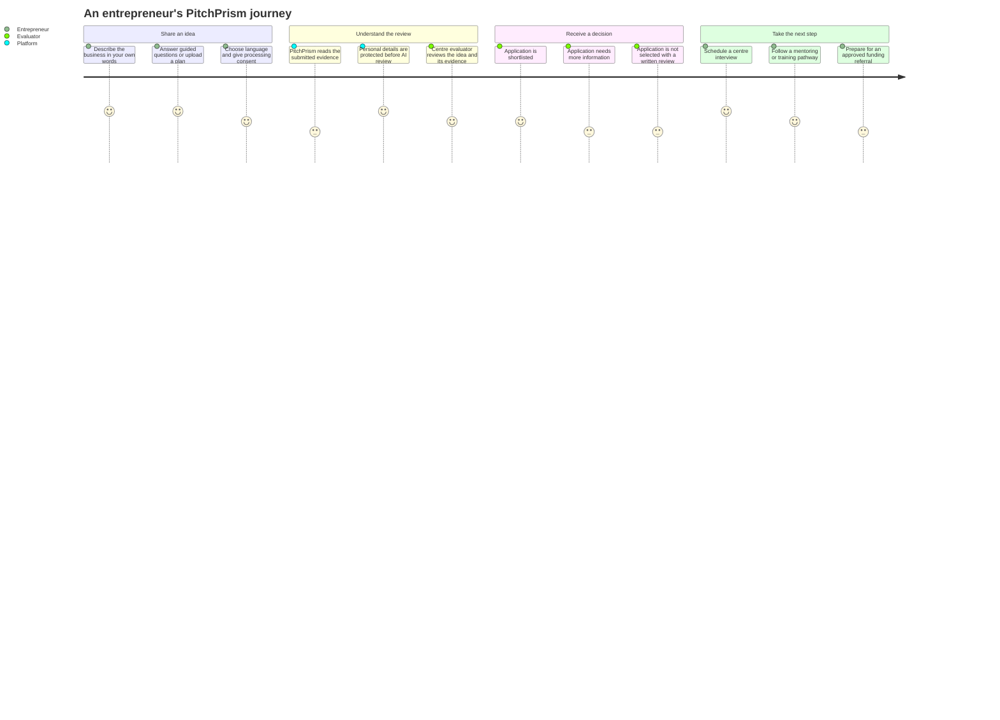
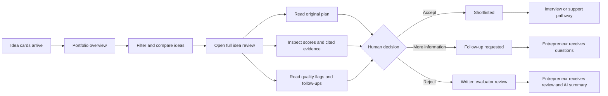
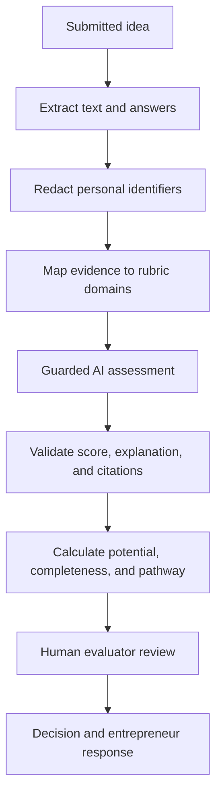
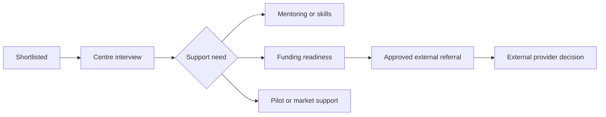

# PitchPrism

## Evidence-led idea screening for Tata STRIVE

PitchPrism helps entrepreneurs turn a business idea into a clear next step.

An entrepreneur can share an idea in their own words. PitchPrism protects the submission, extracts the useful evidence, and gives a centre evaluator a structured way to understand, compare, and respond to it.

The AI helps organise and explain the evidence. A human evaluator always makes the final decision.

## The product from the entrepreneur's point of view

The result is not just a score. It is a response that tells the entrepreneur what happened and what to do next.

## The evaluator's view

## What the evaluator can do

### See the whole portfolio

The dashboard gives the evaluator one view of the centre's ideas:

- total ideas and assessed ideas;
- median potential and completeness;
- review attention signals;
- screening quadrant;
- potential distribution;
- trade benchmarks;
- cohort trends and heatmaps;
- current human outcome for each idea.

### Compare ideas fairly

An evaluator can search and filter by:

- cohort;
- trade;
- language;
- review lane;
- rubric version;
- potential;
- completeness.

Two to four ideas can be compared side by side. Each comparison keeps the idea's own evidence, score, confidence, and missing information visible.

### Open a full idea card

The full review contains:

- overall potential out of 100;
- eight scored business domains;
- computed completeness;
- evidence coverage;
- domain-by-domain reasoning;
- citations to the entrepreneur's answers;
- the original PDF;
- financial checks;
- follow-up questions;
- a summary plan draft;
- evaluator notes and feedback.

### Record the human outcome

The evaluator has three clear choices:

- **Accept and move forward** — shortlist the application for the next process.
- **Request more information** — keep the application open while the entrepreneur fills an evidence gap.
- **Reject application** — record a written explanation that the entrepreneur can understand.

After the decision, the dashboard updates the outcome immediately. The selected idea reopens on its saved review notes so the evaluator can see the decision that was recorded.

## What the entrepreneur receives

### If the idea is accepted

The entrepreneur sees:

- a shortlisted status;
- the evaluator's response;
- the AI screening summary;
- the recommended next action;
- an interview or centre follow-up request when one is created.

The next step can be centre mentoring, skills support, funding-readiness preparation, a pilot, or referral to an approved partner. Selection does not promise a bank loan, an investment, or Tata funding. Those decisions belong to the relevant centre, bank, investor, programme, or partner.

### If more information is needed

The entrepreneur sees:

- what information is missing;
- the questions to answer;
- the current review status;
- what will happen after the answers are received.

### If the idea is rejected

The entrepreneur sees:

- the rejection status;
- the evaluator's written review;
- a compact AI screening summary;
- the strongest evidence in the pitch;
- the areas that need improvement before resubmission.

## How the score is produced

The provisional rubric evaluates eight domains from 1–5:

| Domain | Evidence considered |
| --- | --- |
| Clarity | What is being offered, to whom, and how |
| Customer need | Who buys, why they buy, and the stated problem |
| Market potential | Local demand, research, quantities, and seasonality |
| Feasibility | Resources, premises, materials, suppliers, and funding |
| Competition | Alternatives the entrepreneur has identified |
| Differentiation | Why customers would choose this idea |
| Revenue logic | Prices, costs, volume, and funding reasoning |
| Readiness | Skills, experience, training, or action already taken |

Completeness is calculated separately. Potential is a weighted calculation over the domains that have valid evidence.

A missing answer is not treated as a zero. It is shown as **Not assessed**, so the evaluator knows the difference between a weak answer and an unanswered question.

## How the protected review works

The AI is constrained to the entrepreneur's own cited evidence. It does not decide whether an idea is accepted.

## Safety by design

PitchPrism fails closed when the input or model output cannot be trusted:

- personal identifiers are redacted before inference;
- applicant text is treated as evidence, never as instructions;
- every score must cite real extracted segments;
- scores must use the expected structure and 1–5 range;
- unsupported citations and duplicate domains are rejected;
- missing evidence remains unscored;
- the assessment is run twice so disagreement can be surfaced;
- invalid extraction or unavailable model capability produces a pending or unassessable state;
- human evaluators can inspect the original plan before deciding.

## Batch review

The evaluator can upload several supported idea PDFs in one batch.

The batch view provides:

- drag-and-drop upload;
- per-file progress;
- sequential evaluation;
- pause and resume;
- retry for individual failures;
- side-by-side comparison of completed results.

Batch previews are browser-session results for demonstrations. Saved production assessments follow the consent-gated centre workflow.

## What happens after selection

PitchPrism treats selection as the start of support, not a funding guarantee.

A selected idea can move through:

The platform records the stage and next action. A bank, investor, government scheme, Tata STRIVE programme, or other partner makes its own eligibility and funding decision.

## Product architecture

| Layer | Responsibility |
| --- | --- |
| Entrepreneur app | Idea capture, language, consent, follow-up, and outcome |
| Evaluator dashboard | Portfolio comparison, evidence review, decisions, and feedback |
| Backend API | Authentication, permissions, organisation scope, consent, and persistence |
| Assessment pipeline | Extraction, redaction, evidence mapping, scoring, and validation |
| Shared contracts | Consistent domain types across the app, API, and AI worker |
| Audit trail | Records important assessment and decision events |

## Current scope

The evaluator experience currently supports the known English digital two-page idea brief families and synthetic demonstration cases.

The following remain separate integration work:

- arbitrary PDF layouts and scans;
- multilingual extraction at production quality;
- durable bulk import and ZIP workflows;
- final funding-provider integrations;
- calendar, SMS, WhatsApp, and email delivery.

## Privacy and trust

Real applicant information must remain private. Personal details are scoped by organisation and permission, and are not copied into prompts, fixtures, logs, screenshots, or public documentation.

PitchPrism is designed around a simple promise:

> The entrepreneur's words remain the evidence. The evaluator remains the decision-maker. The next step remains visible.
