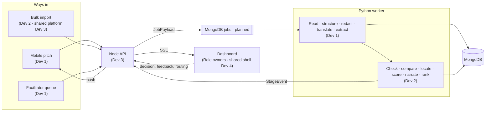
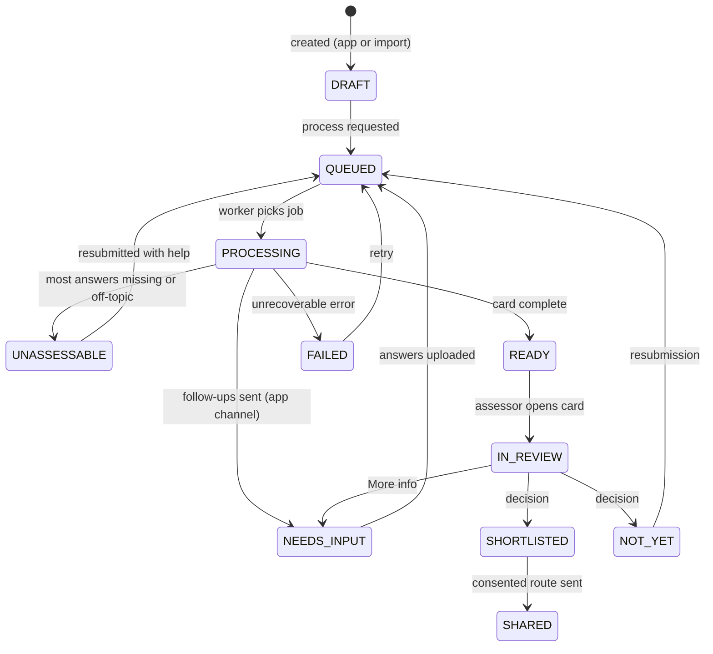
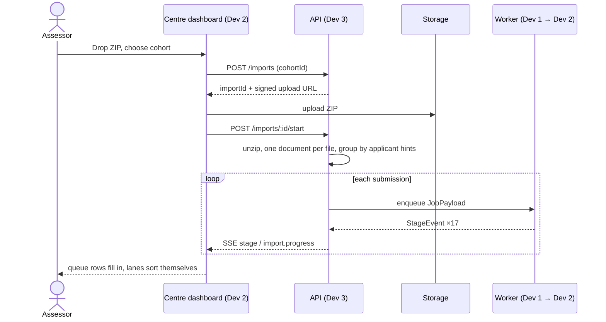
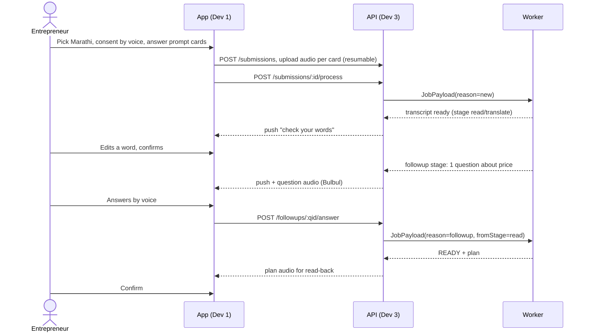
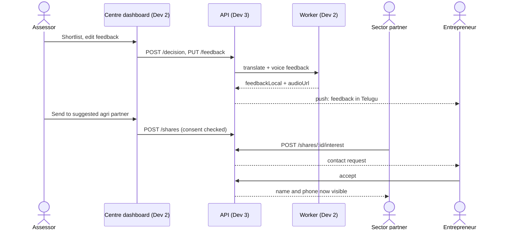
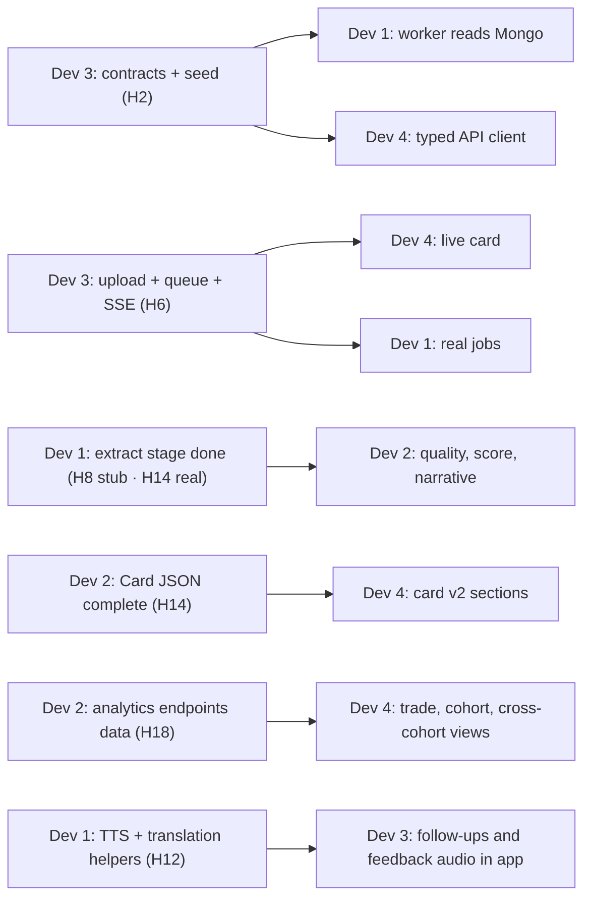

# Flow

How a submission moves through PitchPrism, who owns each step, and what the four of us hand to each other during the 30 hours. Read this with [decision.md](decision.md); contracts named here live in `packages/contracts`.

**Current ownership (D-23):** Dev 1 = entrepreneur/facilitator + ingestion/language · Dev 2 = centre/cohort + intelligence/eval · Dev 3 = HQ + auth/contracts/platform · Dev 4 = partner types + shared web shell/UI. Every developer owns UI, API, data and integration for their roles. See [the duty index](duties/README.md).

**Local AI update (D-24):** every AI task uses a validated local provider; no hosted inference or automatic fallback. Mobile records offline and queues uploads; heavy compute stays on the worker. Missing capabilities remain pending/failed explicitly. See [local AI setup](../ai/README.md) and [the implementation matrix](implementation-matrix.md).

**Runtime update (D-26):** Redis/BullMQ/Redis Streams are removed. MongoDB jobs with atomic leases and durable stage events are the planned queue replacement; no queue consumer is claimed. `pnpm dev:local` provides a persistent database plus seeded API/dashboard now. iOS development builds are included alongside the primary Android target; Firebase configuration remains pending.

**Phase:** the scaffold/auth foundation is implemented first. Business flow below is the target architecture, not a claim that the queue, AI pipeline, SSE or review features already exist. Older 30-hour scheduling/Dev-number handoff references below are historical; the new role duty briefs and D-23 supersede their staffing assignments.

---

## Part 1 · Product flow

### 1.1 The whole system, one picture



### 1.2 Submission lifecycle

One status field, one owner per transition. The dashboard lanes (W-09) are views over these states plus flags.



| Transition | Who sets it |
| --- | --- |
| → DRAFT, → QUEUED | API (Dev 3) |
| → PROCESSING, → NEEDS_INPUT, → UNASSESSABLE, → READY, → FAILED | Worker (Dev 1 sets PROCESSING; Dev 2 sets the outcome) |
| → IN_REVIEW, → SHORTLISTED, → NOT_YET, → SHARED | API on dashboard actions (Dev 3, triggered from Dev 4's UI) |

### 1.3 Pipeline stages and hand-off

The worker runs stages in order. After each one it saves results and emits a `StageEvent`, so the card fills in live (A-28). **The hand-off between Dev 1 and Dev 2 is the `extract` stage:** when it finishes, `submission.qa`, `submission.fields` and the transcript segments are final, and Dev 2's stages read only from them.

| # | Stage key | Owner | Reads | Writes | Card section it unlocks |
| --- | --- | --- | --- | --- | --- |
| 1 | `ingest` | Dev 1 | uploaded files | `documents` | Header: format chips |
| 2 | `classify` | Dev 1 | documents | `submission.templateId`, page scripts | Header: template |
| 3 | `read` | Dev 1 | documents | raw segments (STT, text layer, OCR) | Original viewer |
| 4 | `structure` | Dev 1 | raw segments | `submission.qa` (paired, canonical field, overwrite history) | Q&A list |
| 5 | `redact` | Dev 1 | qa, segments | entrepreneur PII, redacted segments, blur boxes | — |
| 6 | `translate` | Dev 1 | segments | `textEn`, `lang`, `translit` | Side-by-side text |
| 7 | `extract` | Dev 1 | translated qa | `submission.fields`, summary, problem addressed | Summary and fields |
| 8 | `quality` | Dev 2 | fields, qa | flags, completeness, financial checks, duplicates | Data-quality panel |
| 9 | `followup` | Dev 2 | flags | follow-up questions or request for information | Missing info box |
| 10 | `normalise` | Dev 2 | fields | tradeKey, sector, location with geo and precision | Trade and map pin |
| 11 | `similar` | Dev 2 | fields, trade, geo | embedding, similarity links | Similar ideas |
| 12 | `local` | Dev 2 | geo, trade, profile | places, statistics, schemes | Local market |
| 13 | `score` | Dev 2 | fields, flags, local | `evaluation` (domains, potential, completeness, band, quadrant, pathway) | Spectrum bar, scores |
| 14 | `narrative` | Dev 2 | evaluation | strengths, gaps, risks, to-validate, interview questions, plan | Narrative |
| 15 | `rank` | Dev 2 | evaluations | `rankSnapshots` | Trade and cohort rank |
| 16 | `feedback` | Dev 2 | evaluation | English feedback draft | Feedback editor |
| 17 | `route` | Dev 2 | trade, district, consents | route suggestions | Routing panel |

If `quality` marks a submission Unassessable, stages 10–17 are skipped except `followup`, which drafts the request in the applicant's language.

### 1.4 Contracts in one place

These are summaries; the JSON Schemas in `packages/contracts/schemas/` are authoritative (D-03).

```jsonc
// JobPayload — API → worker (MongoDB "jobs" collection, claimed with an atomic lease; D-26)
{ "jobId": "uuid", "submissionId": "ObjectId", "fromStage": "ingest", "reason": "new|followup|rescore|retry", "rubricVersionId": "ObjectId", "requestedBy": "userId|entrepreneurId" }

// StageEvent — worker → MongoDB capped "stageEvents" collection → API → SSE event "stage" (planned; D-26, D-29)
{ "submissionId": "ObjectId", "ownerOrgId": "ObjectId", "stage": "translate", "status": "started|done|skipped|failed", "at": "ISO", "ms": 812, "summary": { "segments": 24, "languages": ["te", "en"] } }

// Segment — the unit every claim points to
{ "segId": "s_0007", "source": { "type": "audio|pdf|text", "documentId": "…", "page": 2, "bbox": [x0, y0, x1, y1], "start": 41.2, "end": 63.9 }, "text": "…", "lang": "te", "textEn": "…", "translit": "…", "struck": false, "supersededBy": null, "confidence": 0.93 }

// QA — one question-answer pair after structuring
{ "qId": "q4", "question": "…", "questionLang": "hi", "answerSegIds": ["s_0007"], "canonicalField": "market_research", "state": "answered|missing|not_asked|irrelevant", "overwrites": [{ "from": "Rs 20,000", "to": "Rs 60,000 per month", "segId": "s_0019" }] }

// Flag — every data-quality finding
{ "key": "implausible", "severity": "info|warn|block", "message": "Monthly revenue is 105× the investment", "evidence": ["s_0031", "check:revenue_vs_investment"] }

// Domain score inside an Evaluation
{ "key": "market_potential", "score": 4, "reason": "…", "evidence": ["s_0007", "s_0008"], "confidence": "high", "runs": [4, 4] }
```

SSE event names on `GET /events`: `stage`, `submission.status`, `import.progress`, `queue.changed`. The dashboard needs nothing else to stay live.

### 1.5 Flow: bulk import (the opening of the demo)



### 1.6 Flow: voice pitch with a follow-up (Sunita)



### 1.7 Flow: decision, feedback and routing



---

## Part 2 · Build flow (30 hours)

### 2.1 Milestones

Everyone stops for 10 minutes at each checkpoint: show what runs, name what is blocked, re-route help. No slides.

| Hour | Milestone | Proof it's done |
| --- | --- | --- |
| H0–H2 | **Kickoff.** Repo, contracts v1, seed data, persistent local MongoDB or Mongo-only Docker, demo script agreed | `pnpm dev` and `make worker` both start; schemas generate types |
| H2 | ✅ **M1 · Contracts frozen** | `packages/contracts` tagged v1 |
| H8 | ✅ **M2 · Walking skeleton** | Upload one English Idea Brief PDF in the dashboard → worker reads, extracts, scores with a stub → card renders with live stage events |
| H14 | ✅ **M3 · Every format reads** | All three sets go through: digital PDF, handwritten scan, audio. First eval run published. Mobile records and uploads a pitch |
| H20 | ✅ **M4 · Intelligence on** | Similar ideas, local market, ranks, trade and cohort views, follow-up loop, routing work end to end |
| H24 | 🧊 **M5 · Feature freeze** | Full eval run on 55 files; only fixes after this |
| H24–H26 | **Fix week** (two hours) | Worst eval failures fixed; cache warmed for all demo files |
| H26–H30 | **Rehearse** | Demo run three times on a real low-end phone; backup video recorded by H28; deck final |

Take rest in staggered two-hour shifts after M3 so that someone from each half (Python, JS) is always awake.

### 2.2 Who unblocks whom



**Rule for being blocked:** never wait. Build against fixtures. Every owner publishes a fixture for what they produce before the real thing works:

| Fixture | Owner | Ready by | Path |
| --- | --- | --- | --- |
| 3 complete `Card` JSONs (Ramesh Goud, Suresh Reddy overwritten, Mohan Lal unassessable) | Dev 2 | H3 | `packages/contracts/fixtures/cards/` |
| `StageEvent` replay stream for one submission | Dev 1 | H4 | `packages/contracts/fixtures/events/` |
| Seed DB dump (orgs, users, cohorts, trades, rubric) | Dev 3 | H2 | `data/seed/` |
| Analytics responses (trade, cohort, compare, clusters) | Dev 2 | H10 | `packages/contracts/fixtures/analytics/` |

### 2.3 Definition of done (for any task)

1. It works on an organiser file named in the manifest, not only a toy input.
2. Types come from `packages/contracts`; nothing re-declares a contract by hand.
3. It emits its `StageEvent` (worker) or handles loading, empty and error states (UI).
4. No personal data in logs, prompts, fixtures or screenshots.
5. One line added to the owner's duty file under "Done", with the requirement ID.
